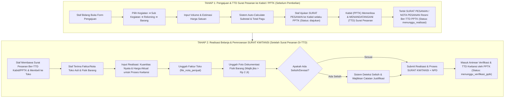
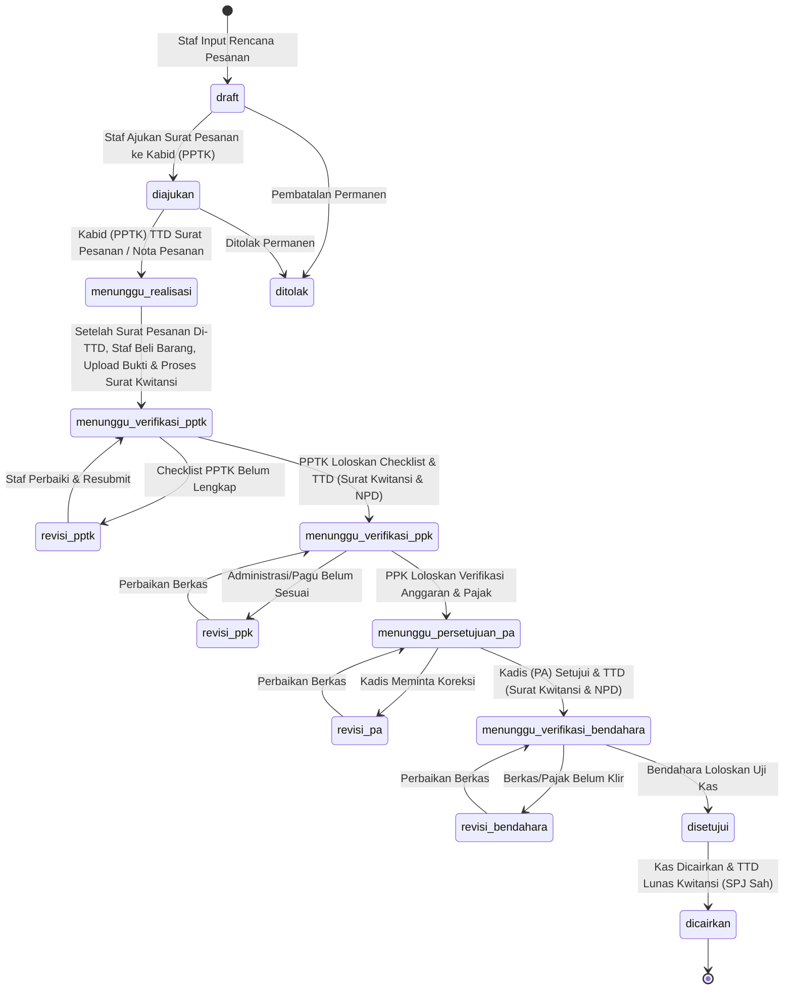

# Pedoman & Aturan Pengembangan (AGENTS.md)

Dokumen ini adalah pedoman baku dan aturan wajib untuk AI Agent dan pengembang dalam memelihara dan mengembangkan proyek **Sakti (Sistem Administrasi, Kinerja, dan Tata Informasi)**.

---

## 1. Stack Teknologi & Versi

Aplikasi ini dibangun menggunakan arsitektur modern:
- **PHP**: 8.3+
- **Laravel Framework**: 12.x / 13.x
- **Backend Admin & Panel**: Filament 4.x / 5.x (Full Filament Native)
- **Database**: MySQL 8.0+
- **Autentikasi**: Laravel Sanctum (Mobile & API), Filament Shield (RBAC Panel)
- **Klien Mobile Pegawai**: Flutter App (`absensi_flutter`)

> **PENTING (WAJIB):** DILARANG menghasilkan kode berdasarkan asumsi Filament 2 atau Filament 3. Semua komponen, schema, table, dan method wajib menggunakan sintaks Filament 4/5 native. Seluruh backend admin dikelola penuh menggunakan Filament.

---

## 2. Struktur Proyek Filament 4/5

Struktur resource mengikuti konvensi Filament terbaru dengan pemisahan `Schemas/`, `Tables/`, `Pages/`, `Widgets/`, dan `Infolists/`:

```txt
app/
└── Filament/
    ├── Resources/
    │   └── [NamaPlural]s/
    │       ├── [Nama]Resource.php
    │       ├── Schemas/
    │       │   ├── [Nama]Form.php
    │       │   └── [Nama]Infolist.php
    │       ├── Tables/
    │       │   └── [NamaPlural]Table.php
    │       ├── Pages/
    │       │   ├── Create[Nama].php
    │       │   ├── Edit[Nama].php
    │       │   ├── List[NamaPlural].php
    │       │   └── View[Nama].php
    │       ├── RelationManagers/
    │       └── Widgets/
    ├── Pages/
    ├── Widgets/
    └── Clusters/
```

### Signature Method Wajib Filament 4/5
```php
public static function form(Schema $schema): Schema
public static function table(Table $table): Table
```

### Redirect URL Standar
Di halaman `CreateRecord` dan `EditRecord`:
```php
protected function getRedirectUrl(): string
{
    return $this->getResource()::getUrl('index');
}
```

---

## 3. Aturan Form & Lokalisasi Tanggal (Indonesia)

### A. Namespace Wajib Layout vs Input Components (Filament 4/5)
> **PERINGATAN KERAS (WAJIB DIPATUHI):** Pada Filament 4.x / 5.x, komponen layout / container telah berpindah dari Forms ke Schemas. DILARANG mengimpor Section atau Grid dari Forms namespace!
- **Wajib Gunakan (Filament 4/5 Native)**:
  ```php
  use Filament\Schemas\Components\Section;
  use Filament\Schemas\Components\Grid;
  use Filament\Schemas\Components\Group;
  use Filament\Schemas\Components\Tabs;
  use Filament\Schemas\Components\Wizard;
  use Filament\Schemas\Components\Wizard\Step;
  use Filament\Schemas\Components\Utilities\Get;
  use Filament\Schemas\Components\Utilities\Set;
  ```
- **DILARANG KERAS (Akan Menghasilkan Fatal Error "Class Not Found")**:
  ```php
  use Filament\Forms\Components\Section; // SALAH BESAR (HANYA ADA DI FILAMENT 2/3)
  use Filament\Forms\Components\Grid;    // SALAH
  use Filament\Forms\Components\Group;   // SALAH
  ```
- Komponen input nilai (Fields) tetap menggunakan namespace Forms:
  ```php
  use Filament\Forms\Components\TextInput;
  use Filament\Forms\Components\Select;
  use Filament\Forms\Components\DatePicker;
  use Filament\Forms\Components\TimePicker;
  use Filament\Forms\Components\DateTimePicker;
  use Filament\Forms\Components\FileUpload;
  use Filament\Forms\Components\Repeater;
  use Filament\Forms\Components\Textarea;
  use Filament\Forms\Components\Hidden;
  use Filament\Forms\Components\Toggle;
  use Filament\Forms\Components\Checkbox;
  use Filament\Forms\Components\CheckboxList;
  use Filament\Forms\Components\Radio;
  ```

### B. Aturan Format Tanggal & Validasi
1. **Komponen Native**: Gunakan komponen native Filament di atas, hindari custom HTML manual.
2. **Format Tanggal Indonesia (Wajib)**:
   - Form `DatePicker`: Selalu sertakan `->displayFormat('d/m/Y')`
   - Form `DateTimePicker`: Selalu sertakan `->displayFormat('d/m/Y H:i')`
   - Table `TextColumn`: Gunakan `->date('d/m/Y')` atau `->dateTime('d/m/Y H:i')`
   - Hindari format default bahasa Inggris seperti `d-M-Y` yang menampilkan singkatan bulan Inggris (e.g. `Oct`).
3. **Validasi Lengkap**: Validasi wajib diterapkan di form component (`->required()`, `->numeric()`, dsb.), Form Request / Closure rules, dan database constraint.

---

## 4. Aturan Table & Query Optimization

1. **Table Columns**:
   - Selalu gunakan `->searchable()` dan `->sortable()` pada kolom yang relevan.
   - Gunakan komponen siap pakai: `TextColumn`, `IconColumn`, `ImageColumn`, `BadgeColumn`, `ToggleColumn`.
   - Hindari render HTML manual di view table.
2. **Eager Loading & Anti N+1**:
   - Pada resource data besar, wajib gunakan `modifyQueryUsing()` dengan `with()`, `select()`, dan `withCount()`.
   - DILARANG menggunakan `Model::all()` pada resource atau halaman dengan volume data besar.

---

## 5. Domain & Alur Bisnis Aplikasi

1. **Master Kepegawaian, Profil Instansi & Konfigurasi Sistem Terpadu**:
   - **Master Data ➔ `Profil Instansi & OPD` (`InstansiResource`)**: Khusus mengelola data kedinasan resmi: Nama Dinas/Instansi, Kode SKPD (SIPD), Sub Unit Organisasi, Alamat Kantor Resmi, Akun Kepala Dinas (Kadis) & Nama Gelar Lengkap, serta Logo Resmi Instansi (disk `public`).
   - **Pengaturan ➔ `Konfigurasi Sistem` (`PengaturanAplikasiResource`)**: Khusus mengelola parameter teknis aplikasi: Nama Sistem (SAKTI), Sub-Judul (Kepanjangan), Deskripsi Singkat, Titik Koordinat GPS Peta & Radius Toleransi Geofencing Presensi, serta Versi Sistem & Kontak Pengembang.
   - **Sinkronisasi Otomatis Dua-Arah (Bidirectional Sync)**: Model `Instansi` dan `PengaturanAplikasi` saling menyinkronkan data secara otomatis saat disimpan via callback `booted()`. Accessor cadangan memastikan seluruh modul lama (`SpjPrintController`, `CetakLaporanController`, `Absensi.php`, dsb.) tetap 100% kompatibel dan tidak ada query yang error.
   - Relasi atasan-bawahan via `atasan_id` pada model `User`.
   - **Aturan Pimpinan / Kadis**: Kepala Dinas merupakan pimpinan tertinggi di dinas sehingga:
     - `bidang_id` = `null` (tidak terikat bidang).
     - `atasan_id` = `null` (tidak memiliki atasan langsung di internal dinas).
     - Tab khusus di List Pegawai: "Pimpinan / Tanpa Bidang".
   - **Tipe Kerja Pegawai**:
     - `status_kerja`: `wfo` (Work From Office) atau `wfh` (Work From Home).
     - Pegawai `wfh` dapat melakukan absensi secara fleksibel (lokasi/koordinat bebas tanpa batasan geofencing kantor).
   - **Biodata Pegawai Lengkap**:
     - Jenjang Pendidikan (`S3`, `S2`, `S1`, `D3`, `SLTA`, `SMP`, `SD`), Jurusan, Gelar Depan & Belakang.
     - Nomor NPWP & Tanggal NPWP (`displayFormat('d/m/Y')`), Nomor Taspen, Agama, Alamat, No. Telp / HP, Email Pribadi.
2. **Mesin Presensi & Log Absensi**:
   - `MesinAbsensi` (ZKTeco IP/Port) dan `LogAbsensi` (tarik log mesin via UDP/TCP socket atau input mobile).
3. **Rekap Presensi Harian (`AbsensiHarian`)**:
   - Mengelompokkan log masuk & pulang pegawai per hari kerja.
   - Status: `hadir`, `terlambat`, `tidak_hadir`, `izin`, `sakit`, `dinas_luar`.
4. **Laporan Harian Kinerja (`Lhk` & `LhkPekerjaan`)**:
   - Syarat pembuatan LHK: Pegawai wajib memiliki absensi harian lengkap (masuk & pulang) pada tanggal bersangkutan.
   - Memuat detail pekerjaan harian yang terhubung ke `Aktivitas` & `RencanaAksi`.
   - Menghitung durasi menit, output bukti URL/foto, dan verifikasi atasan (`menunggu`, `disetujui`, `ditolak`).
5. **Penilaian Reputasi Pegawai (`Reputasi`)**:
   - Penilaian peer-to-peer antar rekan kerja (1 - 5 bintang) beserta tanggal penilaian format Indonesia dan catatan review.
6. **Pengadaan Barang & SPJ Keuangan Terpadu (`PengajuanSpj`)**:
   - Integrasi pengadaan barang oleh staf bidang hingga terbitnya dokumen pertanggungjawaban (SPJ).
   - Melibatkan rantai verifikasi berjenjang: Pemohon (Staf) ➔ PPTK (Kabid) ➔ PPK (Kasubag Keuangan) ➔ PA (Kadis) ➔ Pencairan (Bendahara Pengeluaran).
   - Menghasilkan 3 output PDF terstandardisasi: Nota Pesanan, Kwitansi Pembayaran, dan Nota Pencairan Dana (NPD).

---

## 6. Autentikasi, Query, & Type Hinting (Anti Warning Intelephense)

1. **Autentikasi User**:
   Gunakan `\Illuminate\Support\Facades\Auth::user()` atau sertakan anotasi PHPDoc agar IDE dan linter mengenali model `User`:
   ```php
   /** @var \App\Models\User|null $user */
   $user = auth()->user();
   ```
2. **Query Eloquent Builder**:
   - Hindari pemanggilan langsung method dinamis pada static Model jika Intelephense memberikan false positive "expected 1 argument".
   - Gunakan `Model::query()->count()`, `Model::query()->where('column', '=', $value)->get()`.
3. **Options Select Component**:
   - Hindari mengembalikan `Collection` langsung pada closure `->options()`. Selalu sertakan `->all()` atau `->toArray()` (contoh: `Model::pluck('nama', 'id')->all()`).

---

## 7. Standar Presensi, Shift Kerja, Toleransi & Pengisian LHK

### A. Jendela Waktu Presensi (Attendance Windows) & Jam Kerja Fleksibel
Parameter waktu absensi dikelola terpusat pada menu **Jadwal / Shift Kerja** (`jadwal_kerjas`) tanpa redundansi di Pengaturan Instansi:
1. **Buka Absen Masuk**: Default `06:00:00` WIB (jam paling awal sistem/mesin menerima tap masuk).
2. **Jam Masuk Resmi**: Default `07:30:00` WIB (Senin - Kamis & Jumat).
3. **Toleransi Keterlambatan**: Disimpan dalam kolom `toleransi_terlambat_menit` (misal 15 menit: rentang `07:30` s.d `07:45` masih dianggap tepat waktu / hadir).
4. **Tutup Absen Masuk**: Default `09:00:00` WIB. Di atas batas toleransi s.d pukul 09:00 dicatat sebagai status `terlambat`. Lewat pukul 09:00 jendela masuk ditutup dan pegawai dicatat `tidak_hadir` (alpa), serta tombol pulang mobile dikunci.
5. **Mulai Buka Absen Pulang**: Sesuai jam pulang resmi hari tersebut (Senin–Kamis `16:00:00`, Jumat `16:30:00` atau konfigurasi dinas).
6. **Tutup Absen Pulang**: Default `23:59:00` WIB (batas akhir pengambilan absen pulang di malam hari).

### B. Otomatisasi Jam Pulang Khusus Hari Jumat
- Menggunakan `Carbon::parse($tanggal)->dayOfWeekIso === 5` (Jumat).
- Sistem otomatis memakai `jam_masuk_jumat` dan `jam_pulang_jumat` tanpa perlu campur tangan manual admin setiap minggunya.

### C. Dinas Luar (DL) & Izin Resmi
- Pegawai berstatus **Dinas Luar** (`jenis_kehadiran = 'dinas_luar'`) otomatis dihitung **Hadir Penuh**.
- Jam masuk dan pulang terisi otomatis mengikuti jam jadwal hari tersebut.
- **LHK Langsung Terbuka**: Pegawai dinas luar berhak langsung membuat dan mengisi Laporan Harian Kinerja (LHK).

### D. Penanganan "Lupa Absen Pulang" & Filter Monitoring Cepat (Admin)
Di Resource `AbsensiHarian`:
1. **Tab Filter Cepat**:
   - **Semua Data**: Menampilkan seluruh riwayat.
   - **Lengkap**: Pegawai yang sudah tap Masuk dan Pulang (LHK siap diverifikasi atasan).
   - **Belum Pulang**: Pegawai yang sudah Masuk tetapi belum tap Pulang.
   - **Dinas Luar / Izin**: Pegawai dengan surat tugas / izin resmi.
   - **Tidak Hadir / Alpa**: Pegawai yang tidak mengambil absen masuk maupun pulang.
2. **Bulk Action 1-Klik Sakti**:
   - Tombol **"Set Jam Pulang Massal"** pada tab *Belum Pulang*.
   - Admin dapat mencentang seluruh pegawai yang tertinggal absen pulang dan mengisinya dengan jam pulang resmi hari tersebut secara serentak dalam 1 detik.

### E. Penentuan Otomatis Pegawai Tidak Hadir (Alpa)
- Jika lewat batas tutup absen masuk (`09:00:00`) seorang pegawai belum tap masuk dan tidak memiliki pengajuan izin/dinas luar yang disetujui, status dicatat sebagai `tidak_hadir`.
- Pegawai berstatus `tidak_hadir` otomatis **terkunci dari pengisian LHK** pada hari tersebut.

---

## 8. Widget Stat Card & Table Filter Synchronization

Ketika card widget pada Filament digunakan sebagai filter instan:
1. **URL Generator Widget**:
   Sertakan parameter query eksplisit selain `tableFilters`:
   ```php
   Stat::make('Pendidikan S1', $s1Count)
       ->url(UserResource::getUrl('index', [
           'tableFilters' => ['jenjang_pendidikan' => ['value' => 'S1']],
           'jenjang' => 'S1',
       ]));
   ```
2. **Table Query Hook**:
   Pastikan `configure(Table $table)` memiliki handler parameter query pada `modifyQueryUsing()`:
   ```php
   $table->modifyQueryUsing(function (Builder $query) {
       if ($jenjang = request()->query('jenjang')) {
           $query->where('jenjang_pendidikan', '=', $jenjang);
       }
   });
   ```

---

## 9. Pedoman Antarmuka Livewire 3/4 & Mobile PWA

Seluruh arsitektur komponen Livewire pada aplikasi **Sakti** terpusat pada pedoman teknis berikut:

### A. Arsitektur & Peran Livewire (Terkoneksi Penuh ke Filament & REST API)
1. **Sumber Data Tunggal (Single Source of Truth)**:
   - Seluruh data yang tampil pada klien Mobile PWA (`Dashboard`, `Absensi`, `Riwayat`, `LHK`, `Profil`, serta integrasi SPJ) **100% bersumber dari tabel database Filament** (`absensi_harian`, `log_absensi`, `lhks`, `users`, `pengaturan_aplikasis`, `pengajuan_spj`).
   - Dilarang membuat data fiktif atau hardcode pada komponen mobile.
2. **Keselarasan dengan REST API**:
   - Endpoint API (`/api/absensi`, `/api/dashboard`, `/api/lhk`, `/api/me`) mengembalikan format JSON yang sinkron dengan data Filament Admin dan PWA Mobile.
   - Setiap perubahan status kehadiran, log jam masuk/pulang, sumber perangkat (`mesin`/`mobile`), maupun cetak dokumen langsung mencerminkan data aktual yang terlihat di Panel Admin Filament.
3. **Klien Web Mobile (PWA Pegawai)**:
   - Terletak di `app/Livewire/Mobile/` dan `resources/views/livewire/mobile/`.
   - Layout Utama: `resources/views/components/layouts/mobile.blade.php`.
   - Perutean: Menggunakan full-page components yang diregistrasikan di `routes/web.php` dengan awalan `/mobile`. Halaman root `/` menyajikan **Landing Portal Gerbang Masuk** (`welcome.blade.php`) dengan tombol pilihan Pegawai dan Administrator.
4. **Shortcut Admin**: Jika pengguna terautentikasi memiliki peran `admin` atau `super_admin`, antarmuka mobile dashboard menyediakan tombol pintas langsung ke panel Filament `/admin`.

### B. Navigasi & Tata Letak Mobile (Sticky Bottom Nav & Floating FAB)
Layout mobile mengadopsi standar modern aplikasi mobile (Glassmorphism & Floating Navigation Bar):
1. **Sticky Floating Bottom Navigation Bar**:
   - Menu navigasi bawah berposisi tetap (`position: fixed; bottom: 0`), memiliki efek *backdrop blur* dan rounded pill (`rounded-[28px]`).
   - Struktur Menu:
     1. **Beranda**: Mengarah ke `route('mobile.dashboard')`.
     2. **Riwayat**: Mengarah ke `route('mobile.riwayat')`.
     3. **Center Elevated Floating Action Button (FAB)**: Tombol bulat menonjol di tengah untuk **ABSEN** (`route('mobile.absensi')`). Tombol ini selalu muncul di setiap halaman dan mudah dijangkau dengan ibu jari.
     4. **LHK**: Mengarah ke `route('mobile.lhk.index')`.
     5. **Profil**: Mengarah ke `route('mobile.profil')` (Profil lengkap mandiri ala MyASN).
2. **SPA Navigasi**:
   - Seluruh link antarhalaman mobile wajib menyertakan atribut `wire:navigate` untuk transisi halaman instan tanpa reload penuh.
3. **Safe Area & Padding**:
   - Konten halaman dibungkus class `.content-area` dengan padding bawah minimal `pb-28` agar elemen formulir dan tombol aksi tidak tertutup oleh bottom bar terapung.

### C. Logika & Aturan Bisnis Presensi Mobile
1. **Format Jam Server**:
   - Jam aktif server ditampilkan pada dashboard dan halaman absensi dengan format digital `HH:MM WIB` menggunakan pemisah titik dua `:` berkedip (*blinking colon*) setiap 1 detik tanpa menyertakan detik untuk tampilan yang ringkas dan tenang.
2. **Statistik 8-Card Kehadiran Bulan Berjalan**:
   Dashboard menyajikan 8 kartu statistik kehadiran:
   - **Hadir**: Pegawai yang hadir tepat waktu atau terlambat.
   - **Terlambat**: Pegawai yang tap masuk lewat dari batas toleransi.
   - **Dinas Luar**: Pegawai dengan penugasan kedinasan luar kantor.
   - **Plg Cepat (Pulang Cepat)**: Pegawai yang tap keluar sebelum jam pulang resmi jadwalnya.
   - **Izin**: Pengajuan izin yang disetujui.
   - **Sakit**: Keterangan sakit.
   - **Alpa (Tanpa Keterangan)**: Tidak hadir dan tidak ada konfirmasi izin/DL.
   - **LHK**: Akumulasi total laporan kinerja yang sudah disubmit bulan ini.
3. **Validasi Wajib Absen Masuk Sebelum Absen Keluar**:
   - Sistem menolak pengambilan absen keluar/pulang jika pegawai belum mengambil absen masuk pada pagi hari.
   - Jika pegawai membuka halaman presensi pada sore hari tanpa riwayat masuk, sistem menampilkan banner peringatan merah: *"Anda tidak dapat mengambil absen pulang karena tidak mengambil absen masuk pagi ini. Status Anda hari ini tercatat Tidak Hadir / Alpa."*

### D. Modul Profil Pegawai Mobile (Model Tab MyASN)
Halaman profil pegawai di mobile (`App\Livewire\Mobile\Profil`) mengadopsi struktur infolist MyASN yang bersih dan interaktif:
1. **5 Tab Navigasi Horizontal**:
   - **Data Utama**: NIP, NIK, Jenis Kelamin, Tempat/Tgl Lahir, Agama, No. HP/WA, Email Dinas, Email Pribadi, dan Alamat Domisili.
   - **Golongan**: Golongan/Ruang, Pangkat Pembina, Eselon, NPWP, BPJS Kesehatan, dan No. Taspen.
   - **Jabatan**: Nama Jabatan, Bidang Dinas, Atasan Langsung, Tipe Kerja (WFH/WFO), Shift Kerja, dan PIN ID Mesin.
   - **Pendidikan**: Jenjang Pendidikan (S3/S2/S1/D3/SLTA/SMP/SD), Jurusan/Prodi, Gelar Depan, dan Gelar Belakang.
   - **Keluarga**: Nomor KK, NIK, dan Alamat Domisili Keluarga.
2. **Fitur Edit Profil Mandiri**:
   - Pegawai dapat menekan tombol **"Edit Profil"** untuk memperbarui data kontak, alamat domisili, data administrasi kependudukan, mengganti foto profil (avatar upload), dan mengubah kata sandi mandiri.

### E. Pedoman Sintaks & Standar Kode Livewire 3/4
Setiap komponen Livewire baru atau hasil refactor wajib mematuhi aturan berikut:
1. **Deklarasi Class & Properties**:
   - Gunakan PHP 8.2+ Typed Properties:
     ```php
     public string $search = '';
     public ?int $selectedId = null;
     public bool $isEditing = false;
     ```
   - Hindari menyimpan objek Query Builder atau Closure pada property publik Livewire (karena tidak dapat diserialisasi ke JSON). Simpan ID atau array data primitif.
2. **Binding & Direktif Template**:
   - Gunakan `wire:model.live` untuk pencarian/filter reaktif instan.
   - Gunakan `wire:model.blur` pada input formulir panjang untuk menghemat request jaringan HTTP.
   - **DILARANG** menggunakan `wire:model.lazy` (sintaks usang Livewire 2).
3. **Event Dispatching**:
   - Pengiriman event dari komponen PHP:
     ```php
     $this->dispatch('notify', [
         'type' => 'success',
         'title' => 'Berhasil!',
         'message' => 'Data berhasil disimpan.',
     ]);
     ```
   - **DILARANG** menggunakan `$this->emit()` (sintaks usang Livewire 2).
4. **Optimasi Performa & Render**:
   - Selalu tambahkan `wire:key` pada setiap perulangan `@foreach`:
     ```html
     @foreach ($riwayat as $item)
         <div wire:key="riwayat-{{ $item->id }}">...</div>
     @endforeach
     ```
   - Gunakan atribut layout modern:
     ```php
     #[Layout('components.layouts.mobile')]
     #[Title('Judul Halaman')]
     ```
   - Gunakan `#[Lazy]` untuk pemuatan komponen berat di latar belakang.

---

## 10. Arsitektur Portal Masuk, Autentikasi Peran & Pemisahan Akses (Admin vs Pegawai/Flutter)

Aplikasi memiliki dua ranah antarmuka utama yang dipisahkan secara tegas berdasarkan peran pengguna (*Role-Based Access Control*):

### A. Halaman Depan Portal Utama (`/`)
- Halaman root `/` menampilkan **Portal Gerbang Masuk** terpadu (`resources/views/welcome.blade.php`).
- Menyajikan dua pilihan akses utama:
  1. **Tombol Masuk Pegawai (Presensi & LHK Mobile PWA)**: Mengarah ke `route('mobile.login')` (atau jika sudah terautentikasi langsung ke `route('mobile.dashboard')`).
  2. **Tombol Masuk Administrator (Panel Filament Admin)**: Mengarah ke `/admin/login` (atau jika sudah terautentikasi langsung ke `/admin`).
- Menampilkan identitas dinas/instansi dari model `PengaturanAplikasi`, jam digital real-time, status user aktif (jika sudah login), dan tombol keluar/ganti akun.

### B. Proteksi Akses Panel Filament Admin (`canAccessPanel`)
- Model `User` mengimplementasikan interface `Filament\Models\Contracts\FilamentUser`.
- Method `canAccessPanel(Panel $panel): bool` memvalidasi hak akses:
  ```php
  public function canAccessPanel(Panel $panel): bool
  {
      return $this->hasAnyRole(['super_admin', 'admin']);
  }
  ```
- **Aturan Keamanan (PENTING)**: Pegawai biasa (hanya memiliki role `pegawai`) yang mencoba mengakses `/admin` atau login via panel admin akan ditolak otomatis oleh sistem (**HTTP 403 Forbidden**).

### C. Alur Pengguna Administrator (Akses Ganda & Switcher Cepat)
- Administrator sistem (`super_admin` dan `admin`) pada umumnya juga merupakan pegawai dinas yang wajib diabsen dan mengisi LHK.
- Oleh karena itu, user admin juga memiliki role `pegawai`.
- **Navigasi Bolak-Balik Terintegrasi**:
  1. **Dari Filament ke Mobile**: Di menu avatar Filament (pojok kanan atas), terdapat menu item **"Presensi Mobile Pegawai"** (`route('mobile.dashboard')`).
  2. **Dari Mobile ke Filament**: Pada dashboard Mobile PWA (`livewire.mobile.dashboard`), jika user memiliki role `admin`/`super_admin`, tersedia tombol pintas badge **"Admin"** (`/admin`) di samping tombol logout.

### D. Pedoman Bagi Klien Mobile Flutter (`absensi_flutter`)
Untuk pengembangan klien mobile Flutter:
1. **Autentikasi API**: Menggunakan Laravel Sanctum melalui endpoint `POST /api/login`.
2. **Validasi Role pada Response Login**:
   - Endpoint login API mengembalikan data profil pengguna beserta array `roles`.
   - Klien Flutter ditujukan **khusus untuk operasional Pegawai** (Presensi GPS/Geofencing, Log Kehadiran, Submit LHK, & Profil).
   - Pengguna dengan role `pegawai`, `admin`, maupun `super_admin` dapat menggunakan aplikasi Flutter untuk melakukan presensi harian.
   - Manajemen sistem (CRUD master data, tarik log mesin, manajemen user, dsb.) **TIDAK** diimplementasikan di Flutter, melainkan diarahkan untuk diakses via Filament Admin Panel di browser desktop/laptop.

---

## 11. Arsitektur & Alur Kerja (Workflow) Integrasi Keuangan & SPJ Terpadu

Modul ini mengintegrasikan seluruh siklus pengelolaan keuangan belanja dinas—mulai dari perencanaan belanja oleh bidang, pemesanan sebelum pembelian, realisasi fisik dan belanja, verifikasi administrasi dan kepatuhan anggaran berjenjang, pembuatan dokumen pertanggungjawaban (**SPJ**) terstandardisasi secara paperless, hingga pencairan kas oleh Bendahara Pengeluaran.

---

### A. Prinsip Utama Sistem Keuangan SAKTI
1. **Sistem Terintegrasi Satu-Pintu**: Modul keuangan SAKTI bukan sekadar aplikasi input pengadaan barang, melainkan sistem pengelolaan utuh yang mencakup pengajuan belanja, realisasi pembelian, verifikasi administrasi berjenjang, persetujuan pejabat berwenang, penerbitan dokumen resmi SPJ, dan pencairan dana kas daerah.
2. **Keterlacakan Penuh (*End-to-End Auditability*)**: Setiap tahapan memiliki rekam jejak digital (*audit trail*) yang tidak dapat dimanipulasi, mencatat identitas pelaku, peran saat bertindak, catatan hasil pemeriksaan, dan waktu penindakan.
3. **Prinsip Belanja Daerah: Pengurangan Sisa Pagu RKA (Bukan Penambahan Stok Gudang)**:
   - **Rincian Belanja (RKA) sebagai Single Source of Truth**: Dalam tata kelola keuangan pemerintah daerah (APBD), belanja barang/jasa berpijak pada DPA/RKA. Setiap baris item belanja telah memiliki kuota **Pagu Volume** dan **Pagu Anggaran**.
   - **Realisasi Belanja Menyerap Kuota**: Pembelian barang melalui SPJ hakikatnya adalah **realisasi belanja yang mengurangi Sisa Pagu (Volume & Rp) di RKA**, bukan menambah stok fisik gudang komersial. Oleh karena itu, menu navigasi `StokBarangResource` dinonaktifkan (`$shouldRegisterNavigation = false`) demi menghilangkan redundansi dan menyatukan seluruh kendali kuota belanja ke **Rincian Belanja (RKA)**.

---

### B. Pemisahan Tegas Dua Tahap Belanja: Surat Pesanan (Di-TTD Kabid/PPTK) vs Proses Surat Kwitansi

Sistem memisahkan alur belanja dan penerbitan dokumen secara tegas menjadi 2 tahapan kronologis yang **tidak boleh terbalik atau dilompati**:



> **ATURAN BAKU URUTAN DOKUMEN & STOK BARANG (WAJIB DIPEDOMANI):**
> 1. **Hanya Barang yang Memiliki Stok yang Bisa Diajukan**: Pada form pengajuan Surat Pesanan, pilihan barang **WAJIB difilter hanya menampilkan barang yang memiliki stok tersedia (`stok_tersedia > 0` pada tabel `stok_barangs` sesuai Bidang dan Kode Rekening)**. Barang yang stoknya kosong (`0`) atau belum terdaftar di stok bidang tidak dapat diajukan, dan jumlah volume yang diajukan tidak boleh melebihi `stok_tersedia`.
> 2. **Staf Mengajukan Surat Pesanan ke Kabid (PPTK)**: Langkah pertama wajib dimulai dengan staf mengajukan **Surat Pesanan (Nota Pesanan)** kepada **Kepala Bidang (Kabid) selaku PPTK**.
> 3. **Kabid (PPTK) Menandatangani Surat Pesanan**: Kabid selaku PPTK memverifikasi kebutuhan barang dan **menandatangani (TTD) Surat Pesanan**. Identitas PPTK langsung terekam pada Surat Pesanan.
> 4. **Setelah Surat Pesanan Di-TTD, Baru Diproses Surat Kwitansinya**: **Surat Kwitansi Pembayaran** (beserta **Nota Pencairan Dana / NPD**) **HANYA DAPAT DIPROSES SETELAH Surat Pesanan ditandatangani oleh Kabid (PPTK)** dan realisasi pembelian beserta bukti faktur/dokumentasi barang telah diinput. Dilarang memproses atau menerbitkan Kwitansi sebelum Surat Pesanan di-TTD oleh Kabid (PPTK).

1. **Tahap 1: Pengajuan & Penandatanganan Surat Pesanan oleh Kabid/PPTK (Sebelum Pembelian)**:
   - Staf bidang memilih Bidang, Kegiatan, Subkegiatan, Kode Rekening Belanja, dan Katalog Barang.
   - Mengisi volume kuantitas rencana dan estimasi harga satuan.
   - Sistem melakukan *auto-calculate* subtotal per item dan total nilai belanja.
   - Staf mengajukan **Surat Pesanan** kepada **Kepala Bidang (Kabid) selaku PPTK** (`status: diajukan`).
   - **Kabid selaku PPTK** menyetujui dan **menandatangani (TTD) Surat Pesanan** tersebut. Sistem menerbitkan **Surat Pesanan / Nota Pesanan** resmi yang telah bertanda tangan PPTK. Surat Pesanan ini dibawa oleh staf sebagai dasar legalitas pemesanan barang ke penyedia/toko rekanan.
   - Status beralih ke: `menunggu_realisasi`.
2. **Tahap 2: Realisasi Pembelian & Pemrosesan Surat Kwitansi (Setelah Surat Pesanan Di-TTD)**:
   - Setelah Surat Pesanan ditandatangani Kabid (PPTK) dan pembelian selesai dilakukan di penyedia/toko, staf kembali ke sistem untuk menginput realisasi fisik dan belanja guna **memproses Surat Kwitansi Pembayaran**.
   - Mengisi kuantitas aktual yang terbeli dan harga satuan faktur toko sesungguhnya.
   - Mengunggah berkas bukti sah:
     - `file_nota_penjual`: Scan/foto faktur atau nota asli berstempel dari rekanan penjual (wajib untuk seluruh nilai transaksi).
     - `file_dokumentasi_barang`: Foto fisik barang nyata hasil pembelian. **Wajib mutlak** apabila nilai total transaksi belanja **di atas Rp 2.000.000,-**.
   - **Komparasi Nilai & Deteksi Deviasi**:
     - Sistem membandingkan nilai pengajuan awal pada Surat Pesanan dengan nilai realisasi faktur belanja secara otomatis.
     - Jika terdapat perbedaan nominal atau barang (selisih lebih/kurang), sistem mencatat deviasi tersebut dan mewajibkan staf mengisi kolom *justifikasi selisih* sebelum **Surat Kwitansi & NPD** diserahkan ke tahap verifikasi dan TTD PPTK, PPK, PA (Kadis), dan Bendahara.

---

### C. Master Data Terpusat, Relasi Database, & Pemisahan Arsitektur

Master data dikelola terpusat oleh **Admin Keuangan** untuk menjamin standarisasi penamaan dan pengkodean rekening daerah:
1. **Entitas Master Data Keuangan**:
   - **Master Bidang** (`bidangs`): Struktur bidang dinas pengusul anggaran (menggunakan tabel eksisting Sakti).
   - **Master Kegiatan** (`master_kegiatan`): Kode dan nomenklatur kegiatan resmi dinas (`kode_kegiatan`, `nama_kegiatan`).
   - **Master Sub Kegiatan** (`master_sub_kegiatan`): Sub-kegiatan turunan (`kegiatan_id`, `kode_sub_kegiatan`, `nama_sub_kegiatan`).
   - **Master Kode Rekening** (`kode_rekenings` / `master_rekening`): Kode rekening belanja daerah (misal: belanja ATK, cetak, konsumsi, belanja modal, dll).
   - **Master Barang Persediaan** (`master_barangs`): Katalog standar barang persediaan (`kode_barang`, `nama_barang`, `satuan_id`, `spesifikasi`, `harga_satuan_standar`).
   - **Satuan Barang** (`satuans`): Standar satuan unit/barang (rim, pack, pcs, dus, dll).
   - **Alokasi Pagu Anggaran** (`pagu_sub_kegiatans`): Pagu pagu batas belanja per sub-kegiatan dan kode rekening dalam tahun anggaran berjalan.
2. **Cascading Dependent Dropdown Reaktif (Filament 4/5)**:
   - Form entri pengajuan menerapkan filter bertingkat berurutan:
     $$\text{Bidang} \longrightarrow \text{Kegiatan} \longrightarrow \text{Sub Kegiatan} \longrightarrow \text{Kode Rekening} \longrightarrow \text{Katalog Barang}$$
   - Dropdown menggunakan `->live()` di Filament: saat Kegiatan dipilih, opsi Sub Kegiatan langsung terfilter; saat Sub Kegiatan dipilih, opsi Kode Rekening dan Barang hanya menampilkan alokasi belanja yang sah sesuai pagu sub kegiatan bersangkutan. Dilarang memunculkan rekening atau barang di luar peruntukan subkegiatan tersebut.
3. **Pemisahan Tabel Transaksi SPJ vs Stok Persediaan**:
   - **`pengajuan_spj`**: Header transaksi SPJ memuat `nomor_pengajuan`, `bidang_id`, `kegiatan_id`, `sub_kegiatan_id`, `tanggal_pengajuan`, `total_nilai_rencana`, `total_nilai_realisasi`, status, berkas unggahan, dan snapshot identitas para pejabat penandatangan.
   - **`detail_pengajuan_spj`**: Rincian item barang memuat `rekening_id`, `barang_id`, `kuantitas_rencana`, `harga_rencana`, `kuantitas_realisasi`, `harga_realisasi`, `subtotal_realisasi`.
   - **`verifikasi_spj`**: Menyimpan checklist pemeriksaan per tahapan jabatan.
   - **`riwayat_status_spj`**: Log audit jejak workflow perubahan status.
   - **`rincian_anggaran_belanja`**: Satu-satunya sumber kendali alokasi pagu belanja (`volume`, `pagu_total`, `volume_realisasi`, `nilai_realisasi`, `sisa_volume`, `sisa_anggaran`). Pencairan SPJ secara otomatis menambah realisasi dan memotong sisa pagu kuota RKA.

---

### D. Struktur Fleksibel Jabatan Keuangan (Dynamic Role Assignment)

1. **Prinsip Fungsional Fleksibel**:
   - Jabatan keuangan (PPTK, PPK, PA, Bendahara) **TIDAK DIKUNCI** secara permanen ke nama jabatan struktural pada tabel organisasi.
   - Jabatan keuangan adalah penugasan fungsional SK yang dikonfigurasikan fleksibel kepada akun pegawai (`User`) melalui modul penugasan pejabat dinas.
2. **Hierarki Standar Konfigurasi Instansi Pengguna**:
   - **PPTK (Pejabat Pelaksana Teknis Kegiatan)**: Melekat pada **Kepala Bidang (Kabid)** yang mengampu program/kegiatan bersangkutan.
   - **PPK (Pejabat Pembuat Komitmen)**: Melekat pada **Kasubag Keuangan**.
   - **PA (Pengguna Anggaran)**: Melekat pada **Kepala Dinas (Kadis)** selaku pemegang kekuasaan pengelolaan keuangan daerah di dinas.
   - **Bendahara Pengeluaran**: Pegawai fungsional keuangan yang ditunjuk resmi menguji tagihan dan mencairkan pembayaran kas dinas.
3. **Dukungan Pergantian Pejabat (*Immunity to Turnover*)**:
   - Sistem mendukung mutasi/pergantian pejabat kapan pun tanpa perlu mengubah baris kode program.
   - **Snapshot Identitas Transaksi**: Setiap kali pejabat memverifikasi, menyetujui, atau menandatangani, sistem menyimpan snapshot identitas pejabat saat itu (User ID, Nama Lengkap, NIP, Pangkat/Golongan, dan Jabatan) ke dalam riwayat audit dan metadata SPJ. Dengan demikian, dokumen SPJ yang terbit di masa lalu tetap sah dan tidak akan berubah meski pejabat instansi di kemudian hari berganti orang.

---

### E. Checklist Verifikasi Spesifik per Tahapan Jabatan

Setiap tahap pemeriksaan memiliki formulir checklist kelayakan tersendiri. Pemeriksa wajib mengisi checklist sebelum dapat meloloskan berkas:

| Pejabat Pemeriksa | Daftar Item Checklist Kepatuhan | Dokumen yang Ditandatangani |
|:---|:---|:---|
| **1. PPTK (Kabid)** | • Kesesuaian barang dengan kebutuhan riil kegiatan.<br>• Kesesuaian volume kuantitas dan kewajaran harga.<br>• Kesesuaian barang fisik yang dibeli dengan nota pesanan.<br>• Kelengkapan lembar Nota Pesanan.<br>• Kelengkapan faktur/nota asli rekanan penjual.<br>• Dokumentasi fisik barang (wajib jika belanja > Rp 2.000.000,-).<br>• Kesesuaian kelengkapan dokumen pertanggungjawaban awal. | 1. **Nota Pesanan** (bersama Rekanan Toko)<br>2. **Kwitansi Pembayaran**<br>3. **Nota Pencairan Dana (NPD)** |
| **2. PPK (Kasubag Keu)** | • Kesesuaian pembebanan Program, Kegiatan, dan Subkegiatan.<br>• Ketepatan pembebanan Kode Rekening Belanja daerah.<br>• Ketersediaan sisa pagu anggaran dinas.<br>• Kesesuaian nominal pengajuan vs realisasi belanja (justifikasi deviasi).<br>• Pemeriksaan keabsahan dokumen dan perhitungan potongan pajak (PPN/PPh).<br>• Kelengkapan administrasi keuangan perundang-undangan. | *Paraf Verifikasi Kepatuhan Administrasi & Anggaran* |
| **3. PA (Kepala Dinas)** | • Penelitian hasil verifikasi uji kelayakan PPTK dan PPK.<br>• Persetujuan nilai akhir pertanggungjawaban belanja daerah.<br>• Persetujuan penerbitan Kwitansi dan Nota Pencairan Dana (NPD).<br>• Pembubuhan tanda tangan otorisasi akhir pengguna anggaran. | 1. **Kwitansi Pembayaran**<br>2. **Nota Pencairan Dana (NPD)** |
| **4. Bendahara Pengeluaran** | • Pemeriksaan final seluruh dokumen bukti pendukung transaksi.<br>• Verifikasi kewajiban pemotongan/pemungutan pajak (PPN/PPh) sesuai regulasi.<br>• Kesesuaian nominal kas yang dibayarkan kepada penerima.<br>• Kelengkapan seluruh tanda tangan pejabat (PPTK, PPK, PA, Rekanan).<br>• Pencatatan tanggal pencairan, nomor BKU, dan realisasi kas keluar. | 1. **Kwitansi Pembayaran** (Tanda Tangan Pelunasan Kas) |

- **Mekanisme Revisi & Pengembalian**: Jika terdapat kekurangan checklist pada tahap mana pun, pemeriksa wajib mengisikan catatan perbaikan dan menekan aksi **Kembalikan untuk Revisi**. Berkas akan kembali ke staf/pejabat pembuat dokumen terkait status revisi spesifik.

---

### F. Siklus Status Workflow Eksplisit (Strict State Machine)

Sistem memberlakukan mesin status yang ketat (*strict state machine*). Pengguna dilarang melompati tahapan persetujuan:



#### Daftar Status Resmi Sistem:
1. `draft`: Draf rencana Surat Pesanan oleh staf bidang.
2. `diajukan`: Staf mengajukan **Surat Pesanan (Nota Pesanan)** kepada **Kepala Bidang (Kabid) selaku PPTK** untuk ditandatangani.
3. `menunggu_realisasi`: **Surat Pesanan telah disetujui & ditandatangani (TTD) oleh Kabid (PPTK)**. Surat Pesanan resmi terbit, staf belanja ke rekanan toko, dan siap dilanjutkan ke pemrosesan **Surat Kwitansi**.
4. `menunggu_verifikasi_pptk`: Faktur toko dan foto barang fisik telah diunggah, **Surat Kwitansi Pembayaran & NPD diproses** dan menunggu uji checklist serta TTD Kwitansi oleh PPTK.
5. `revisi_pptk`: Dikembalikan oleh PPTK ke staf karena checklist belum terpenuhi.
6. `menunggu_verifikasi_ppk`: Lolos checklist PPTK & Kwitansi telah di-TTD PPTK, berkas diuji administrasi dan pagu oleh PPK (Kasubag Keuangan).
7. `revisi_ppk`: Dikembalikan oleh PPK karena catatan anggaran/administrasi.
8. `menunggu_persetujuan_pa`: Lolos verifikasi PPK, berkas Surat Kwitansi & NPD menunggu otorisasi final Kepala Dinas (PA).
9. `revisi_pa`: Dikembalikan oleh Kepala Dinas untuk perbaikan.
10. `menunggu_verifikasi_bendahara`: Kadis telah menyetujui & TTD Surat Kwitansi dan NPD, berkas diuji kas oleh Bendahara.
11. `revisi_bendahara`: Dikembalikan oleh Bendahara karena koreksi perhitungan pajak atau bukti.
12. `disetujui`: Berkas 100% lengkap dan sah, siap dibayarkan.
13. `dicairkan`: Dana kas telah diserahkan/ditransfer ke rekanan/pemohon, Surat Kwitansi telah di-TTD Lunas oleh Bendahara, SPJ sah dan terarsip digital.
14. `ditolak`: Pengajuan dibatalkan secara permanen dengan catatan penolakan.

---

### G. Dokumen SPJ Terstandarisasi & Urutan Penerbitan (Auto-Generate PDF via DomPDF)

Sistem wajib menghasilkan 3 dokumen resmi dari satu sumber data transaksi (*Single Source of Truth*) dengan **urutan penerbitan bertahap sesuai status TTD**:
1. **Surat Pesanan / Nota Pesanan (Tahap 1 — Sebelum Pembelian)**:
   - Waktu Terbit: Diajukan oleh Staf ke **Kabid selaku PPTK**, dan **resmi terbit setelah ditandatangani (TTD) oleh Kabid (PPTK)** (`status >= menunggu_realisasi`) sebelum pembelian dilakukan.
   - Isi: Dasar pemesanan barang, nomor surat pesanan, nama toko/rekanan penyedia, rincian barang yang dipesan, volume, harga satuan standar, dan ketentuan pemesanan.
   - Pihak Bertandatangan: **Mengetahui Pengguna Anggaran (Kepala Dinas)** dan **PPTK (Kepala Bidang)**.
2. **Surat Kwitansi Pembayaran (Tahap 2 — Diproses Setelah Surat Pesanan Di-TTD Kabid/PPTK)**:
   - Waktu Terbit: **WAJIB diproses HANYA SETELAH Surat Pesanan ditandatangani oleh Kabid (PPTK)** dan realisasi pembelian barang dilakukan. Sebelum Surat Pesanan di-TTD Kabid/PPTK, Kwitansi belum dapat diterbitkan.
   - Isi: Nomor bukti kas, nominal rupiah realisasi, teks terbilang otomatis dari sistem (*rupiah spelling function*), rincian pembayaran belanja sesuai faktur, nama rekanan penerima dana.
   - Pihak Bertandatangan (Berjenjang):
     1. Rekanan Penerima Dana
     2. PPTK (Kepala Bidang)
     3. PA (Kepala Dinas)
     4. Bendahara Pengeluaran (Tanda lunas bayar)
3. **Nota Pencairan Dana / NPD (Tahap 2 — Diproses Bersama Surat Kwitansi)**:
   - Waktu Terbit: Diproses bersama Surat Kwitansi setelah Surat Pesanan di-TTD Kabid (PPTK) sebagai surat permohonan pencairan kas kepada Bendahara Pengeluaran.
   - Isi: Dasar pengeluaran, nomor NPD, subkegiatan, kode rekening belanja, rincian keperluan belanja, total nominal yang disetujui untuk dicairkan.
   - Pihak Bertandatangan: **PPTK (Kepala Bidang)** dan disetujui oleh **PA (Kepala Dinas)**.
4. **Keamanan & Imutabilitas Dokumen**:
   - Menggunakan tanda tangan digital atau spesimen tanda tangan pejabat berwenang sesuai hak akses.
   - Setiap kali cetak, sistem menyimpan nomor versi dokumen dan riwayat penerbitannya.
   - Dokumen final yang telah berstatus `disetujui` atau `dicairkan` **TERKUNCI PENUH (IMMUTABLE)** dan dilarang dapat diedit diam-diam oleh pihak mana pun.

---

### H. Audit Trail, Keamanan, & Hak Akses (RBAC)

1. **Jejak Audit Menyeluruh (`riwayat_status_spj`)**:
   Setiap perubahan status dan aksi approval wajib tercatat dalam tabel riwayat dengan struktur:
   - `pengajuan_spj_id`: ID transaksi SPJ terkait.
   - `status_sebelumnya`: Status sebelum aksi.
   - `status_berikutnya`: Status baru setelah aksi.
   - `user_id`: Identitas pengguna yang melakukan aksi.
   - `peran_saat_tindakan`: Peran fungsional (`staf`, `pptk`, `ppk`, `pa`, `bendahara`, `admin`).
   - `catatan`: Alasan persetujuan, justifikasi deviasi, atau instruksi perbaikan revisi.
   - `created_at`: Timestamp presisi waktu eksekusi.
2. **Scoping Data & Perlindungan Otorisasi**:
   - **Staf Bidang**: Hanya dapat melihat, mengedit, dan mengunggah bukti untuk transaksi pada bidangnya sendiri (`bidang_id` user).
   - **Pejabat Pemeriksa (PPTK, PPK, PA, Bendahara)**: Hanya dapat melihat antrean dan mengeksekusi tombol aksi approval/revisi sesuai dengan tahap kewenangannya yang aktif.
   - **Proteksi Anti-Bypass**: Seluruh aksi perubahan status wajib divalidasi ketat pada backend melalui Laravel Policy / Gate authorization. Dilarang mengandalkan proteksi tombol tampilan (UI-only) atau mengizinkan manipulasi parameter via URL / REST API / Livewire public property tampering.

---

### I. Panduan Teknis Implementasi (Filament 4/5 & Laravel 12/13)

1. **Service Layer Pattern**:
   Gunakan dedicated service class untuk logika bisnis kompleks, seperti:
   - `App\Services\Spj\SpjWorkflowService`: Mengelola transisi status, validasi state machine, dan pencatatan audit log.
   - `App\Services\Spj\SpjChecklistService`: Mengelola pengisian dan validasi kelayakan checklist.
   - `App\Services\Spj\SpjDocumentService`: Menghasilkan dokumen PDF terstandardisasi (Nota Pesanan, Kwitansi, NPD) menggunakan DomPDF dengan konfigurasi ukuran kertas resmi:
     - **Surat Pesanan Barang**: Kertas **F4 Portrait (215 mm x 330 mm / 609.45 pt x 935.43 pt)**, fit di 1 halaman tanpa lembar kosong kedua.
     - **Kwitansi Pembayaran**: Kertas **F4 Bagi 2 Landscape (215 mm x 165 mm / 609.45 pt x 467.72 pt)**, 4 rangkap (Kwitansi 1 s.d. 4) + lembar belakang TTD PPTK, masing-masing lembar fit presisi di 1 halaman tanpa overflow.
     - **Nota Pencairan Dana (NPD)**: Kertas **F4 Portrait (215 mm x 330 mm)**, fit di 1 halaman.
2. **Database Transactions**:
   Setiap transisi status, perubahan nominal realisasi, penyimpanan checklist, dan pencatatan riwayat audit **WAJIB** dibungkus dalam `DB::transaction()` untuk menjamin integritas data (ACID compliance).
3. **Event & Notifikasi Real-time**:
   Setiap berkas beralih status (misal: diajukan ke PPTK, diteruskan ke PPK/PA, atau dikembalikan untuk revisi), sistem memicu Laravel Event yang mengirimkan notifikasi database / Filament Notification kepada pejabat yang bersangkutan.
4. **Pemeriksaan Database Aktual**:
   Sebelum membuat migration baru, pengembang wajib mengecek skema tabel MySQL aktual proyek (`sakti.sql` dan `persediaan.sql`) untuk memastikan foreign key (`bidangs`, `users`, `kode_rekenings`, `master_barangs`) terhubung presisi tanpa menimbulkan redundansi tabel.

---

## 12. Best Practices Filament (Performance, Security, Code Organization, Testing & Usage)

### A. Performance
- **Eager Loading via `getEloquentQuery()`**: Gunakan `getEloquentQuery()` pada Resource untuk eager load relationships (`with()`, `withCount()`) dan mencegah query N+1.
- **Component Caching di Production**: Aktifkan component caching di production environment dengan perintah `php artisan filament:cache-components`.
- **Pagination & Deferred Loading**: Batasi opsi pagination dan terapkan deferred loading (`->deferLoading()`) untuk dataset berukuran besar agar render awal tabel tetap instan.
- **Cache Perhitungan Berat di Widget**: Selalu cache perhitungan agregasi, statistik berat, atau query analitik pada widget dashboard/overview.

### B. Security
- **Implementasi Kontrak `FilamentUser`**: Selalu implementasikan interface `Filament\Models\Contracts\FilamentUser` pada model `User` dengan method `canAccessPanel()` untuk kontrol hak akses panel admin.
- **Laravel Policies untuk Resource**: Gunakan Laravel Policies untuk otorisasi di level Resource (`viewAny`, `view`, `create`, `update`, `delete`, `restore`, `forceDelete`).
- **Validasi Lengkap Input**: Validasi seluruh input form dengan aturan validasi form yang tepat di level Form Component, Form Request, dan Database Constraint.
- **Jangan Pernah Melewati Otorisasi**: Dilarang mengabaikan atau melewati otorisasi pada environment production.
- **Isolasi Tenant**: Terapkan isolasi tenant yang aman dan teruji jika mengimplementasikan skenario multi-tenant.

### C. Code Organization
- **Organize by Feature**: Struktur direktori di bawah `app/Filament/Resources/` dengan pemisahan sub-direktori `Schemas/`, `Tables/`, `Pages/`, `RelationManagers/`, dan `Widgets/`.
- **Ekstraksi Form & Table Kompleks**: Ekstraksi form dan table kompleks ke dalam class terpisah (misal `[Nama]Form.php` dan `[Nama]Table.php`) agar Resource tetap ramping dan mudah dipelihara.
- **Komponen Form Reusable**: Buat komponen form atau schema reusable untuk pola formulir yang sering digunakan berulang kali.
- **Prinsip Tanggung Jawab Tunggal (*Single Responsibility*)**: Jaga agar setiap Resource fokus pada entitas dan tanggung jawab tunggalnya.
- **Dedicated Pages**: Gunakan dedicated custom pages untuk fungsionalitas di luar operasi CRUD standar.

### D. Testing
- **Uji Seluruh Operasi CRUD**: Uji operasi Create, Read, Update, dan Delete untuk setiap Resource.
- **Validasi Form dengan Berbagai Skenario**: Validasi aturan validasi formulir menggunakan berbagai skenario (data valid, invalid, boundary cases).
- **Uji Fitur Tabel**: Uji fungsionalitas pencarian (*search*), filter (*filters*), pengurutan (*sorting*), serta aksi baris dan massal (*record & bulk actions*).
- **Verifikasi Otorisasi Berdasarkan Peran**: Uji hak akses panel dan resource dengan berbagai role user yang berbeda (`super_admin`, `admin`, `pegawai`).
- **Gunakan Model Factories**: Manfaatkan Laravel Model Factories untuk menghasilkan data uji (*test data*) yang realistis.

### E. When to Use Filament
- Gunakan Filament untuk **seluruh panel administrasi internal, manajemen data terstruktur (CRUD), dashboard analitik & KPI, alur verifikasi dokumen berjenjang, dan tata kelola master data instansi**.
- Antarmuka pegawai non-administratif (presensi selfie GPS harian, log kehadiran, dan portal mandiri MyASN) dikelola melalui klien **Livewire Mobile PWA** dan klien mobile Flutter (`absensi_flutter`) yang terhubung langsung ke database dan API backend Filament.

---

## 13. Format Respon AI (MANDATORY / WAJIB)

> **ATURAN KETAT:** Dilarang memberikan narasi/penjelasan panjang yang tidak diminta ("tidak usah jelaskan"). Langsung berikan respon to the point sesuai format wajib berikut:

### File
```txt
app/...
```

### Kode Final
Kode siap pakai.

### Command
```bash
php artisan optimize:clear
```
*(Tambahkan `php artisan migrate`, `php artisan make:...` bila ada penambahan file/skema)*

### Migration
```txt
Ya / Tidak
```

### Dampak
#### Backend
- ...
#### Frontend
- ...

### Git Commit (WAJIB)
```bash
git add .
git commit -m "type(scope): deskripsi perubahan"
```
*(Dilarang mengakhiri jawaban tanpa bagian Git Commit)*
