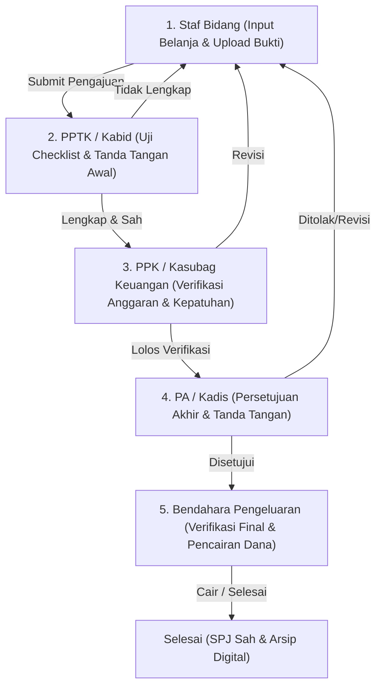

# Pedoman & Aturan Pengembangan (AGENTS.md)

Dokumen ini adalah pedoman baku dan aturan wajib untuk AI Agent dan pengembang dalam memelihara dan mengembangkan proyek **Sakti (Sistem Administrasi, Kinerja, dan Tata Informasi)**.

---

## 1. Stack Teknologi & Versi

Aplikasi ini dibangun menggunakan arsitektur modern:
- **PHP**: 8.3+
- **Laravel Framework**: 12.x / 13.x
- **Backend Admin & Panel**: Filament 4.x / 5.x (Full Filament Native)
- **Database**: MySQL 8.0+
- **Autentikasi**: Laravel Sanctum (Mobile & API), Filament Shield (RBAC Panel)
- **Klien Mobile Pegawai**: Flutter App (`absensi_flutter`)

> **PENTING (WAJIB):** DILARANG menghasilkan kode berdasarkan asumsi Filament 2 atau Filament 3. Semua komponen, schema, table, dan method wajib menggunakan sintaks Filament 4/5 native. Seluruh backend admin dikelola penuh menggunakan Filament.

---

## 2. Struktur Proyek Filament 4/5

Struktur resource mengikuti konvensi Filament terbaru dengan pemisahan `Schemas/`, `Tables/`, `Pages/`, `Widgets/`, dan `Infolists/`:

```txt
app/
└── Filament/
    ├── Resources/
    │   └── [NamaPlural]s/
    │       ├── [Nama]Resource.php
    │       ├── Schemas/
    │       │   ├── [Nama]Form.php
    │       │   └── [Nama]Infolist.php
    │       ├── Tables/
    │       │   └── [NamaPlural]Table.php
    │       ├── Pages/
    │       │   ├── Create[Nama].php
    │       │   ├── Edit[Nama].php
    │       │   ├── List[NamaPlural].php
    │       │   └── View[Nama].php
    │       ├── RelationManagers/
    │       └── Widgets/
    ├── Pages/
    ├── Widgets/
    └── Clusters/
```

### Signature Method Wajib Filament 4/5
```php
public static function form(Schema $schema): Schema
public static function table(Table $table): Table
```

### Redirect URL Standar
Di halaman `CreateRecord` dan `EditRecord`:
```php
protected function getRedirectUrl(): string
{
    return $this->getResource()::getUrl('index');
}
```

---

## 3. Aturan Form & Lokalisasi Tanggal (Indonesia)

1. **Komponen Native**: Gunakan komponen native Filament (`TextInput`, `Select`, `DatePicker`, `TimePicker`, `DateTimePicker`, `FileUpload`, `Toggle`, `Radio`, dll).
2. **Format Tanggal Indonesia (Wajib)**:
   - Form `DatePicker`: Selalu sertakan `->displayFormat('d/m/Y')`
   - Form `DateTimePicker`: Selalu sertakan `->displayFormat('d/m/Y H:i')`
   - Table `TextColumn`: Gunakan `->date('d/m/Y')` atau `->dateTime('d/m/Y H:i')`
   - Hindari format default bahasa Inggris seperti `d-M-Y` yang menampilkan singkatan bulan Inggris (e.g. `Oct`).
3. **Validasi Lengkap**: Validasi wajib diterapkan di form component (`->required()`, `->numeric()`, dsb.), Form Request / Closure rules, dan database constraint.

---

## 4. Aturan Table & Query Optimization

1. **Table Columns**:
   - Selalu gunakan `->searchable()` dan `->sortable()` pada kolom yang relevan.
   - Gunakan komponen siap pakai: `TextColumn`, `IconColumn`, `ImageColumn`, `BadgeColumn`, `ToggleColumn`.
   - Hindari render HTML manual di view table.
2. **Eager Loading & Anti N+1**:
   - Pada resource data besar, wajib gunakan `modifyQueryUsing()` dengan `with()`, `select()`, dan `withCount()`.
   - DILARANG menggunakan `Model::all()` pada resource atau halaman dengan volume data besar.

---

## 5. Domain & Alur Bisnis Aplikasi

1. **Master Kepegawaian & Pengaturan Instansi Terpadu**:
   - `PengaturanAplikasi` (Identitas & Pengaturan Instansi): Menggabungkan profil instansi, logo, kepala dinas, alamat kantor, versi aplikasi, serta titik koordinat & radius geofencing peta interaktif dalam satu menu tunggal (*Single Source of Truth*). Data disinkronkan otomatis ke model `Instansi` demi kompatibilitas query lama (`Instansi::first()`).
   - `InstansiResource`: Dinonaktifkan dari menu navigasi sidebar (`$shouldRegisterNavigation = false`) untuk menghilangkan redundansi.
   - Relasi atasan-bawahan via `atasan_id` pada model `User`.
   - **Aturan Pimpinan / Kadis**: Kepala Dinas merupakan pimpinan tertinggi di dinas sehingga:
     - `bidang_id` = `null` (tidak terikat bidang).
     - `atasan_id` = `null` (tidak memiliki atasan langsung di internal dinas).
     - Tab khusus di List Pegawai: "Pimpinan / Tanpa Bidang".
   - **Tipe Kerja Pegawai**:
     - `status_kerja`: `wfo` (Work From Office) atau `wfh` (Work From Home).
     - Pegawai `wfh` dapat melakukan absensi secara fleksibel (lokasi/koordinat bebas tanpa batasan geofencing kantor).
   - **Biodata Pegawai Lengkap**:
     - Jenjang Pendidikan (`S3`, `S2`, `S1`, `D3`, `SLTA`, `SMP`, `SD`), Jurusan, Gelar Depan & Belakang.
     - Nomor NPWP & Tanggal NPWP (`displayFormat('d/m/Y')`), Nomor Taspen, Agama, Alamat, No. Telp / HP, Email Pribadi.
2. **Mesin Presensi & Log Absensi**:
   - `MesinAbsensi` (ZKTeco IP/Port) dan `LogAbsensi` (tarik log mesin via UDP/TCP socket atau input mobile).
3. **Rekap Presensi Harian (`AbsensiHarian`)**:
   - Mengelompokkan log masuk & pulang pegawai per hari kerja.
   - Status: `hadir`, `terlambat`, `tidak_hadir`, `izin`, `sakit`, `dinas_luar`.
4. **Laporan Harian Kinerja (`Lhk` & `LhkPekerjaan`)**:
   - Syarat pembuatan LHK: Pegawai wajib memiliki absensi harian lengkap (masuk & pulang) pada tanggal bersangkutan.
   - Memuat detail pekerjaan harian yang terhubung ke `Aktivitas` & `RencanaAksi`.
   - Menghitung durasi menit, output bukti URL/foto, dan verifikasi atasan (`menunggu`, `disetujui`, `ditolak`).
5. **Penilaian Reputasi Pegawai (`Reputasi`)**:
   - Penilaian peer-to-peer antar rekan kerja (1 - 5 bintang) beserta tanggal penilaian format Indonesia dan catatan review.
6. **Pengadaan Barang & SPJ Keuangan Terpadu (`PengajuanSpj`)**:
   - Integrasi pengadaan barang oleh staf bidang hingga terbitnya dokumen pertanggungjawaban (SPJ).
   - Melibatkan rantai verifikasi berjenjang: Pemohon (Staf) ➔ PPTK (Kabid) ➔ PPK (Kasubag Keuangan) ➔ PA (Kadis) ➔ Pencairan (Bendahara Pengeluaran).
   - Menghasilkan 3 output PDF terstandardisasi: Nota Pesanan, Kwitansi Pembayaran, dan Nota Pencairan Dana (NPD).

---

## 6. Autentikasi, Query, & Type Hinting (Anti Warning Intelephense)

1. **Autentikasi User**:
   Gunakan `\Illuminate\Support\Facades\Auth::user()` atau sertakan anotasi PHPDoc agar IDE dan linter mengenali model `User`:
   ```php
   /** @var \App\Models\User|null $user */
   $user = auth()->user();
   ```
2. **Query Eloquent Builder**:
   - Hindari pemanggilan langsung method dinamis pada static Model jika Intelephense memberikan false positive "expected 1 argument".
   - Gunakan `Model::query()->count()`, `Model::query()->where('column', '=', $value)->get()`.
3. **Options Select Component**:
   - Hindari mengembalikan `Collection` langsung pada closure `->options()`. Selalu sertakan `->all()` atau `->toArray()` (contoh: `Model::pluck('nama', 'id')->all()`).

---

## 7. Standar Presensi, Shift Kerja, Toleransi & Pengisian LHK

### A. Jendela Waktu Presensi (Attendance Windows) & Jam Kerja Fleksibel
Parameter waktu absensi dikelola terpusat pada menu **Jadwal / Shift Kerja** (`jadwal_kerjas`) tanpa redundansi di Pengaturan Instansi:
1. **Buka Absen Masuk**: Default `06:00:00` WIB (jam paling awal sistem/mesin menerima tap masuk).
2. **Jam Masuk Resmi**: Default `07:30:00` WIB (Senin - Kamis & Jumat).
3. **Toleransi Keterlambatan**: Disimpan dalam kolom `toleransi_terlambat_menit` (misal 15 menit: rentang `07:30` s.d `07:45` masih dianggap tepat waktu / hadir).
4. **Tutup Absen Masuk**: Default `09:00:00` WIB. Di atas batas toleransi s.d pukul 09:00 dicatat sebagai status `terlambat`. Lewat pukul 09:00 jendela masuk ditutup dan pegawai dicatat `tidak_hadir` (alpa), serta tombol pulang mobile dikunci.
5. **Mulai Buka Absen Pulang**: Sesuai jam pulang resmi hari tersebut (Senin–Kamis `16:00:00`, Jumat `16:30:00` atau konfigurasi dinas).
6. **Tutup Absen Pulang**: Default `23:59:00` WIB (batas akhir pengambilan absen pulang di malam hari).

### B. Otomatisasi Jam Pulang Khusus Hari Jumat
- Menggunakan `Carbon::parse($tanggal)->dayOfWeekIso === 5` (Jumat).
- Sistem otomatis memakai `jam_masuk_jumat` dan `jam_pulang_jumat` tanpa perlu campur tangan manual admin setiap minggunya.

### C. Dinas Luar (DL) & Izin Resmi
- Pegawai berstatus **Dinas Luar** (`jenis_kehadiran = 'dinas_luar'`) otomatis dihitung **Hadir Penuh**.
- Jam masuk dan pulang terisi otomatis mengikuti jam jadwal hari tersebut.
- **LHK Langsung Terbuka**: Pegawai dinas luar berhak langsung membuat dan mengisi Laporan Harian Kinerja (LHK).

### D. Penanganan "Lupa Absen Pulang" & Filter Monitoring Cepat (Admin)
Di Resource `AbsensiHarian`:
1. **Tab Filter Cepat**:
   - **Semua Data**: Menampilkan seluruh riwayat.
   - **Lengkap**: Pegawai yang sudah tap Masuk dan Pulang (LHK siap diverifikasi atasan).
   - **Belum Pulang**: Pegawai yang sudah Masuk tetapi belum tap Pulang.
   - **Dinas Luar / Izin**: Pegawai dengan surat tugas / izin resmi.
   - **Tidak Hadir / Alpa**: Pegawai yang tidak mengambil absen masuk maupun pulang.
2. **Bulk Action 1-Klik Sakti**:
   - Tombol **"Set Jam Pulang Massal"** pada tab *Belum Pulang*.
   - Admin dapat mencentang seluruh pegawai yang tertinggal absen pulang dan mengisinya dengan jam pulang resmi hari tersebut secara serentak dalam 1 detik.

### E. Penentuan Otomatis Pegawai Tidak Hadir (Alpa)
- Jika lewat batas tutup absen masuk (`09:00:00`) seorang pegawai belum tap masuk dan tidak memiliki pengajuan izin/dinas luar yang disetujui, status dicatat sebagai `tidak_hadir`.
- Pegawai berstatus `tidak_hadir` otomatis **terkunci dari pengisian LHK** pada hari tersebut.

---

## 8. Widget Stat Card & Table Filter Synchronization

Ketika card widget pada Filament digunakan sebagai filter instan:
1. **URL Generator Widget**:
   Sertakan parameter query eksplisit selain `tableFilters`:
   ```php
   Stat::make('Pendidikan S1', $s1Count)
       ->url(UserResource::getUrl('index', [
           'tableFilters' => ['jenjang_pendidikan' => ['value' => 'S1']],
           'jenjang' => 'S1',
       ]));
   ```
2. **Table Query Hook**:
   Pastikan `configure(Table $table)` memiliki handler parameter query pada `modifyQueryUsing()`:
   ```php
   $table->modifyQueryUsing(function (Builder $query) {
       if ($jenjang = request()->query('jenjang')) {
           $query->where('jenjang_pendidikan', '=', $jenjang);
       }
   });
   ```

---

## 9. Pedoman Antarmuka Livewire 3/4 & Mobile PWA

Seluruh arsitektur komponen Livewire pada aplikasi **Sakti** terpusat pada pedoman teknis berikut:

### A. Arsitektur & Peran Livewire (Terkoneksi Penuh ke Filament & REST API)
1. **Sumber Data Tunggal (Single Source of Truth)**:
   - Seluruh data yang tampil pada klien Mobile PWA (`Dashboard`, `Absensi`, `Riwayat`, `LHK`, `Profil`, serta integrasi SPJ) **100% bersumber dari tabel database Filament** (`absensi_harian`, `log_absensi`, `lhks`, `users`, `pengaturan_aplikasis`, `pengajuan_spj`).
   - Dilarang membuat data fiktif atau hardcode pada komponen mobile.
2. **Keselarasan dengan REST API**:
   - Endpoint API (`/api/absensi`, `/api/dashboard`, `/api/lhk`, `/api/me`) mengembalikan format JSON yang sinkron dengan data Filament Admin dan PWA Mobile.
   - Setiap perubahan status kehadiran, log jam masuk/pulang, sumber perangkat (`mesin`/`mobile`), maupun cetak dokumen langsung mencerminkan data aktual yang terlihat di Panel Admin Filament.
3. **Klien Web Mobile (PWA Pegawai)**:
   - Terletak di `app/Livewire/Mobile/` dan `resources/views/livewire/mobile/`.
   - Layout Utama: `resources/views/components/layouts/mobile.blade.php`.
   - Perutean: Menggunakan full-page components yang diregistrasikan di `routes/web.php` dengan awalan `/mobile`. Halaman root `/` menyajikan **Landing Portal Gerbang Masuk** (`welcome.blade.php`) dengan tombol pilihan Pegawai dan Administrator.
4. **Shortcut Admin**: Jika pengguna terautentikasi memiliki peran `admin` atau `super_admin`, antarmuka mobile dashboard menyediakan tombol pintas langsung ke panel Filament `/admin`.

### B. Navigasi & Tata Letak Mobile (Sticky Bottom Nav & Floating FAB)
Layout mobile mengadopsi standar modern aplikasi mobile (Glassmorphism & Floating Navigation Bar):
1. **Sticky Floating Bottom Navigation Bar**:
   - Menu navigasi bawah berposisi tetap (`position: fixed; bottom: 0`), memiliki efek *backdrop blur* dan rounded pill (`rounded-[28px]`).
   - Struktur Menu:
     1. **Beranda**: Mengarah ke `route('mobile.dashboard')`.
     2. **Riwayat**: Mengarah ke `route('mobile.riwayat')`.
     3. **Center Elevated Floating Action Button (FAB)**: Tombol bulat menonjol di tengah untuk **ABSEN** (`route('mobile.absensi')`). Tombol ini selalu muncul di setiap halaman dan mudah dijangkau dengan ibu jari.
     4. **LHK**: Mengarah ke `route('mobile.lhk.index')`.
     5. **Profil**: Mengarah ke `route('mobile.profil')` (Profil lengkap mandiri ala MyASN).
2. **SPA Navigasi**:
   - Seluruh link antarhalaman mobile wajib menyertakan atribut `wire:navigate` untuk transisi halaman instan tanpa reload penuh.
3. **Safe Area & Padding**:
   - Konten halaman dibungkus class `.content-area` dengan padding bawah minimal `pb-28` agar elemen formulir dan tombol aksi tidak tertutup oleh bottom bar terapung.

### C. Logika & Aturan Bisnis Presensi Mobile
1. **Format Jam Server**:
   - Jam aktif server ditampilkan pada dashboard dan halaman absensi dengan format digital `HH:MM WIB` menggunakan pemisah titik dua `:` berkedip (*blinking colon*) setiap 1 detik tanpa menyertakan detik untuk tampilan yang ringkas dan tenang.
2. **Statistik 8-Card Kehadiran Bulan Berjalan**:
   Dashboard menyajikan 8 kartu statistik kehadiran:
   - **Hadir**: Pegawai yang hadir tepat waktu atau terlambat.
   - **Terlambat**: Pegawai yang tap masuk lewat dari batas toleransi.
   - **Dinas Luar**: Pegawai dengan penugasan kedinasan luar kantor.
   - **Plg Cepat (Pulang Cepat)**: Pegawai yang tap keluar sebelum jam pulang resmi jadwalnya.
   - **Izin**: Pengajuan izin yang disetujui.
   - **Sakit**: Keterangan sakit.
   - **Alpa (Tanpa Keterangan)**: Tidak hadir dan tidak ada konfirmasi izin/DL.
   - **LHK**: Akumulasi total laporan kinerja yang sudah disubmit bulan ini.
3. **Validasi Wajib Absen Masuk Sebelum Absen Keluar**:
   - Sistem menolak pengambilan absen keluar/pulang jika pegawai belum mengambil absen masuk pada pagi hari.
   - Jika pegawai membuka halaman presensi pada sore hari tanpa riwayat masuk, sistem menampilkan banner peringatan merah: *"Anda tidak dapat mengambil absen pulang karena tidak mengambil absen masuk pagi ini. Status Anda hari ini tercatat Tidak Hadir / Alpa."*

### D. Modul Profil Pegawai Mobile (Model Tab MyASN)
Halaman profil pegawai di mobile (`App\Livewire\Mobile\Profil`) mengadopsi struktur infolist MyASN yang bersih dan interaktif:
1. **5 Tab Navigasi Horizontal**:
   - **Data Utama**: NIP, NIK, Jenis Kelamin, Tempat/Tgl Lahir, Agama, No. HP/WA, Email Dinas, Email Pribadi, dan Alamat Domisili.
   - **Golongan**: Golongan/Ruang, Pangkat Pembina, Eselon, NPWP, BPJS Kesehatan, dan No. Taspen.
   - **Jabatan**: Nama Jabatan, Bidang Dinas, Atasan Langsung, Tipe Kerja (WFH/WFO), Shift Kerja, dan PIN ID Mesin.
   - **Pendidikan**: Jenjang Pendidikan (S3/S2/S1/D3/SLTA/SMP/SD), Jurusan/Prodi, Gelar Depan, dan Gelar Belakang.
   - **Keluarga**: Nomor KK, NIK, dan Alamat Domisili Keluarga.
2. **Fitur Edit Profil Mandiri**:
   - Pegawai dapat menekan tombol **"Edit Profil"** untuk memperbarui data kontak, alamat domisili, data administrasi kependudukan, mengganti foto profil (avatar upload), dan mengubah kata sandi mandiri.

### E. Pedoman Sintaks & Standar Kode Livewire 3/4
Setiap komponen Livewire baru atau hasil refactor wajib mematuhi aturan berikut:
1. **Deklarasi Class & Properties**:
   - Gunakan PHP 8.2+ Typed Properties:
     ```php
     public string $search = '';
     public ?int $selectedId = null;
     public bool $isEditing = false;
     ```
   - Hindari menyimpan objek Query Builder atau Closure pada property publik Livewire (karena tidak dapat diserialisasi ke JSON). Simpan ID atau array data primitif.
2. **Binding & Direktif Template**:
   - Gunakan `wire:model.live` untuk pencarian/filter reaktif instan.
   - Gunakan `wire:model.blur` pada input formulir panjang untuk menghemat request jaringan HTTP.
   - **DILARANG** menggunakan `wire:model.lazy` (sintaks usang Livewire 2).
3. **Event Dispatching**:
   - Pengiriman event dari komponen PHP:
     ```php
     $this->dispatch('notify', [
         'type' => 'success',
         'title' => 'Berhasil!',
         'message' => 'Data berhasil disimpan.',
     ]);
     ```
   - **DILARANG** menggunakan `$this->emit()` (sintaks usang Livewire 2).
4. **Optimasi Performa & Render**:
   - Selalu tambahkan `wire:key` pada setiap perulangan `@foreach`:
     ```html
     @foreach ($riwayat as $item)
         <div wire:key="riwayat-{{ $item->id }}">...</div>
     @endforeach
     ```
   - Gunakan atribut layout modern:
     ```php
     #[Layout('components.layouts.mobile')]
     #[Title('Judul Halaman')]
     ```
   - Gunakan `#[Lazy]` untuk pemuatan komponen berat di latar belakang.

---

## 10. Arsitektur Portal Masuk, Autentikasi Peran & Pemisahan Akses (Admin vs Pegawai/Flutter)

Aplikasi memiliki dua ranah antarmuka utama yang dipisahkan secara tegas berdasarkan peran pengguna (*Role-Based Access Control*):

### A. Halaman Depan Portal Utama (`/`)
- Halaman root `/` menampilkan **Portal Gerbang Masuk** terpadu (`resources/views/welcome.blade.php`).
- Menyajikan dua pilihan akses utama:
  1. **Tombol Masuk Pegawai (Presensi & LHK Mobile PWA)**: Mengarah ke `route('mobile.login')` (atau jika sudah terautentikasi langsung ke `route('mobile.dashboard')`).
  2. **Tombol Masuk Administrator (Panel Filament Admin)**: Mengarah ke `/admin/login` (atau jika sudah terautentikasi langsung ke `/admin`).
- Menampilkan identitas dinas/instansi dari model `PengaturanAplikasi`, jam digital real-time, status user aktif (jika sudah login), dan tombol keluar/ganti akun.

### B. Proteksi Akses Panel Filament Admin (`canAccessPanel`)
- Model `User` mengimplementasikan interface `Filament\Models\Contracts\FilamentUser`.
- Method `canAccessPanel(Panel $panel): bool` memvalidasi hak akses:
  ```php
  public function canAccessPanel(Panel $panel): bool
  {
      return $this->hasAnyRole(['super_admin', 'admin']);
  }
  ```
- **Aturan Keamanan (PENTING)**: Pegawai biasa (hanya memiliki role `pegawai`) yang mencoba mengakses `/admin` atau login via panel admin akan ditolak otomatis oleh sistem (**HTTP 403 Forbidden**).

### C. Alur Pengguna Administrator (Akses Ganda & Switcher Cepat)
- Administrator sistem (`super_admin` dan `admin`) pada umumnya juga merupakan pegawai dinas yang wajib diabsen dan mengisi LHK.
- Oleh karena itu, user admin juga memiliki role `pegawai`.
- **Navigasi Bolak-Balik Terintegrasi**:
  1. **Dari Filament ke Mobile**: Di menu avatar Filament (pojok kanan atas), terdapat menu item **"Presensi Mobile Pegawai"** (`route('mobile.dashboard')`).
  2. **Dari Mobile ke Filament**: Pada dashboard Mobile PWA (`livewire.mobile.dashboard`), jika user memiliki role `admin`/`super_admin`, tersedia tombol pintas badge **"Admin"** (`/admin`) di samping tombol logout.

### D. Pedoman Bagi Klien Mobile Flutter (`absensi_flutter`)
Untuk pengembangan klien mobile Flutter:
1. **Autentikasi API**: Menggunakan Laravel Sanctum melalui endpoint `POST /api/login`.
2. **Validasi Role pada Response Login**:
   - Endpoint login API mengembalikan data profil pengguna beserta array `roles`.
   - Klien Flutter ditujukan **khusus untuk operasional Pegawai** (Presensi GPS/Geofencing, Log Kehadiran, Submit LHK, & Profil).
   - Pengguna dengan role `pegawai`, `admin`, maupun `super_admin` dapat menggunakan aplikasi Flutter untuk melakukan presensi harian.
   - Manajemen sistem (CRUD master data, tarik log mesin, manajemen user, dsb.) **TIDAK** diimplementasikan di Flutter, melainkan diarahkan untuk diakses via Filament Admin Panel di browser desktop/laptop.

---

## 11. Arsitektur & Alur Kerja (Workflow) Integrasi Keuangan & SPJ Terpadu

Modul ini mengintegrasikan pengadaan belanja barang/jasa oleh bidang dengan pertanggungjawaban keuangan daerah (**SPJ**) secara paperless, terstandardisasi, dan akuntabel.

### A. Master Data Keuangan & Pengkodean Terpusat
Untuk menjaga konsistensi anggaran dan penamaan rekening daerah, master data dikelola terpusat oleh **Admin Keuangan**:
1. **`master_kegiatan`**: Menyimpan kode dan nomenklatur kegiatan resmi dinas (`kode_kegiatan`, `nama_kegiatan`).
2. **`master_sub_kegiatan`**: Sub-kegiatan turunan dari kegiatan (`kegiatan_id`, `kode_sub_kegiatan`, `nama_sub_kegiatan`).
3. **`master_rekening`**: Kode rekening belanja daerah (misal: belanja ATK, cetak, konsumsi rapat, belanja modal, dll) (`kode_rekening`, `nama_rekening`).
4. **`master_barang`**: Katalog standar barang persediaan (`nama_barang`, `satuan`, `harga_satuan_standar`).

### B. Dynamic Input Form & Entri Belanja (Staf Bidang)
1. **Auto-fill & Dependent Dropdown Reactive**:
   - Staf bidang membuka form pengajuan SPJ.
   - Memilih **Kegiatan**, maka dropdown **Sub Kegiatan** otomatis tersaring secara reaktif (`->live()`).
   - Dropdown **Kode Rekening** dan **Barang** menyesuaikan alokasi belanja sub kegiatan tersebut.
2. **Repeater Detail Belanja & Auto-Calculate**:
   - Menggunakan komponen `Repeater` untuk mendukung pembelian banyak item barang dalam 1 pengajuan (`detail_pengajuan_spj`).
   - Setiap baris item memuat: `rekening_id`, `barang_id`, `kuantitas`, `harga_satuan`, dan `subtotal`.
   - **Kalkulasi Otomatis**: Perubahan `kuantitas` atau `harga_satuan` langsung mengkalkulasi `subtotal` per baris secara real-time dan menjumlahkan total keseluruhan ke field `total_nilai` di form induk.
3. **Prasyarat & Unggah Berkas Bukti Sah**:
   - `file_nota_penjual`: Unggahan faktur / nota asli dari pihak rekanan/toko penjual.
   - `file_dokumentasi_barang`: Foto fisik barang nyata hasil pembelian. **Wajib mutlak** untuk barang/belanja dengan total di atas **Rp 2.000.000,-**.

### C. Struktur Peran Jabatan Keuangan (Financial Roles)
Jabatan keuangan bersifat fungsional-tugas yang fleksibel (dapat dilekatkan ke pegawai mana pun via penugasan SK / konfigurasi sistem), dengan penetapan standar dinas sebagai berikut:
1. **PPTK (Pejabat Pelaksana Teknis Kegiatan)**: Dijabat oleh **Kepala Bidang (Kabid)** yang mengampu kegiatan/sub-kegiatan bersangkutan.
2. **PPK (Pejabat Pembuat Komitmen)**: Dijabat oleh **Kasubag Keuangan**.
3. **PA (Pengguna Anggaran)**: Dijabat oleh **Kepala Dinas (Kadis)** selaku pimpinan tertinggi anggaran dinas.
4. **Bendahara Pengeluaran**: Petugas fungsional keuangan yang memverifikasi transaksi final dan mengeksekusi pencairan kas/dana.

### D. Rantai Verifikasi & Alur Approval Berjenjang (Approval Workflow)
Proses verifikasi dokumen SPJ dilakukan berjenjang dengan daftar uji kepatuhan (checklist):


1. **Tahap 1 - Pengajuan (Staf Bidang)**:
   - Staf menyusun rincian belanja barang, melampirkan faktur rekanan, nota pesanan awal, dan dokumentasi fisik barang.
   - Status: `diajukan`.
2. **Tahap 2 - Pemeriksaan PPTK (Kabid)**:
   - PPTK memeriksa kesesuaian fisik dan administrasi dengan **Daftar Checklist Verifikasi**.
   - Jika memenuhi syarat, PPTK menandatangani lembar **Nota Pesanan**, **Kwitansi**, dan **Nota Pencairan Dana (NPD)**.
   - Status beralih ke verifikasi PPK.
3. **Tahap 3 - Pengujian PPK (Kasubag Keuangan)**:
   - PPK memverifikasi ketersediaan pagu anggaran, ketepatan pembebanan kode rekening, dan kelengkapan bukti transaksi.
   - Status beralih ke persetujuan PA.
4. **Tahap 4 - Otorisasi PA (Kepala Dinas)**:
   - Kepala Dinas selaku PA meneliti dokumen final.
   - Kadis membubuhkan tanda tangan persetujuan resmi pada **Kwitansi** dan **Nota Pencairan Dana (NPD)**.
   - Status beralih ke Bendahara Pengeluaran.
5. **Tahap 5 - Pencairan (Bendahara Pengeluaran)**:
   - Bendahara melakukan audit akhir kepatuhan pajak (PPN/PPh bila ada) dan dokumen pendukung.
   - Bendahara memproses pembayaran/pencairan dana kepada pihak pemohon/rekanan.
   - Status akhir: `dicairkan` (Arsip SPJ Selesai).

### E. Dokumen Output Terstandarisasi (Otomatisasi PDF via DomPDF)
Sistem menyediakan aksi cetak dokumen satu-pintu (**"Cetak Dokumen SPJ"**) yang secara otomatis menghasilkan berkas PDF resmi terstandarisasi:
1. **Nota Pesanan**: Diterbitkan sebelum pembelian barang sebagai dasar pemesanan barang ke penyedia/toko.
2. **Kwitansi Pembayaran**: Format resmi daerah yang otomatis mencantumkan nominal terbilang rupiah, pihak penerima, PPTK, dan PA.
3. **Nota Pencairan Dana (NPD)**: Surat nota dinas otorisasi pencairan anggaran kepada bendahara pengeluaran yang ditandatangani oleh PA/Kadis.

---

## 12. Format Respon AI (MANDATORY / WAJIB)

Setiap kali AI memberikan solusi kode kepada pengguna, AI **WAJIB** menyertakan struktur berikut secara utuh:

### File
```txt
app/...
```

### Kode Final
Kode siap pakai.

### Command
```bash
php artisan optimize:clear
```
*(Tambahkan `php artisan migrate`, `php artisan make:...` bila ada penambahan file/skema)*

### Migration
```txt
Ya / Tidak
```

### Dampak
#### Backend
- Penjelasan dampak pada sistem backend...
#### Frontend
- Penjelasan dampak pada tampilan antarmuka...

### Git Commit (WAJIB)
```bash
git add .
git commit -m "type(scope): deskripsi perubahan"
```
*(Dilarang mengakhiri jawaban tanpa bagian Git Commit)*
