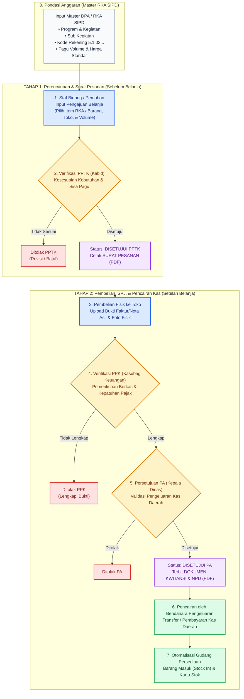
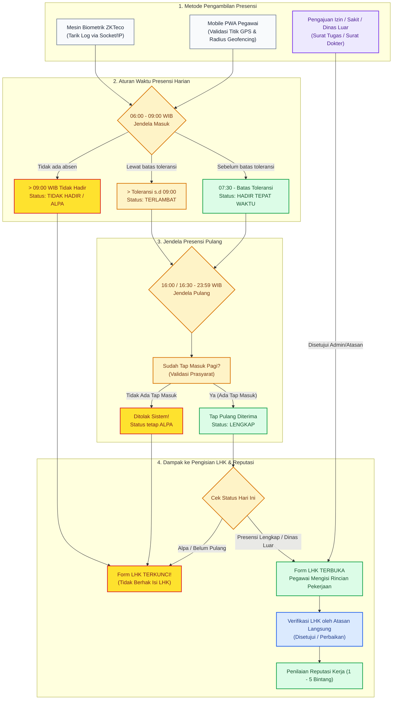
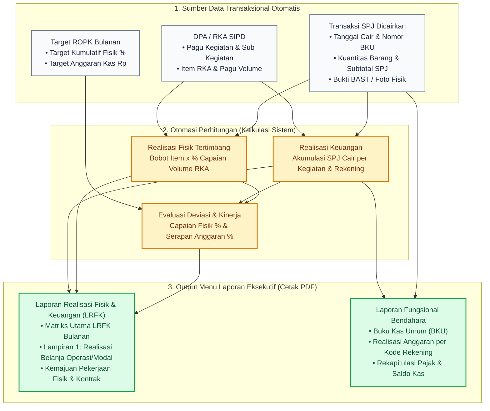

# 📊 Alur Kerja Terpadu Aplikasi SAKTI: Keuangan & Presensi (Absensi)

Dokumen ini menyajikan peta visual dan penjelasan terstruktur untuk dua modul inti dalam aplikasi **SAKTI (Sistem Administrasi, Kinerja, dan Tata Informasi)**:
1. **Modul Pengelolaan Keuangan & SPJ Terpadu** (Alur 2 Tahap: Nota Pesanan hingga Pencairan SPJ).
2. **Modul Presensi & Kinerja Pegawai** (Jendela Absensi Masuk/Pulang hingga Validasi LHK Atasan).

---

## 1. Alur Modul Keuangan & SPJ Terpadu

Modul keuangan mengadopsi prinsip **2 Tahap Belanja Daerah**:
- **Tahap 1**: Persetujuan Pemesanan oleh PPTK (Kabid) sebelum belanja dilakukan.
- **Tahap 2**: Realisasi Pembelian fisik, verifikasi administrasi PPK & PA, penerbitan Kwitansi/NPD, dan pencairan kas oleh Bendahara Pengeluaran.

### Rincian Dokumen & Aktor Keuangan
| Tahapan | Pelaku / Pejabat | Dokumen yang Terbit | Keterangan |
| :--- | :--- | :--- | :--- |
| **Input Pengajuan** | Staf Pemohon | Draft Rincian Belanja | Sistem mengunci input bila volume melebihi sisa pagu RKA. |
| **Persetujuan Pesanan** | Kabid selaku PPTK | **Nota Pesanan Resmi (PDF)** | Menjadi dasar legalitas staf mendatangi toko/penyedia. |
| **Pemeriksaan Berkas** | Kasubag Keu selaku PPK | Lembar Verifikasi SPJ | Memastikan bukti transaksi asli, materai, dan potongan pajak benar. |
| **Persetujuan Belanja** | Kepala Dinas selaku PA | **Kwitansi Pembayaran (PDF)** | Persetujuan tertinggi pengeluaran anggaran dinas. |
| **Pencairan Dana** | Bendahara Pengeluaran | **Nota Pencairan Dana (NPD)** | Kas keluar; item persediaan fisik otomatis tercatat masuk stok. |

---

## 2. Alur Modul Presensi & Kinerja Pegawai (Absensi & LHK)

Presensi pegawai terintegrasi antara **Mesin Biometrik Fingerprint (ZKTeco)** dan **Mobile PWA (GPS Geofencing)**, yang bermuara pada penentuan hak pengisian **Laporan Harian Kinerja (LHK)**.

### Aturan Presensi Khusus
1. **Hari Jumat Otomatis**:
   Sistem otomatis mengenali hari Jumat (`jam_pulang_jumat: 16:30`) tanpa perlu perubahan manual.
2. **Pegawai Dinas Luar (DL)**:
   Surat tugas DL yang disetujui otomatis mencatatkan kehadiran penuh dan membuka akses pengisian LHK.
3. **Pemberian Jam Pulang Massal (1-Klik Admin)**:
   Untuk pegawai yang hadir pagi tetapi lupa tap pulang, admin instansi memiliki tombol bulk action *"Set Jam Pulang Massal"* di tab **Belum Pulang** untuk menyelaraskan status dalam 1 klik.
4. **Pegawai WFH**:
   Pegawai dengan `status_kerja = 'wfh'` dibebaskan dari pembatasan radius geofencing kantor.

---

## 3. Modul Pelaporan Eksekutif: LRFK & Laporan Fungsional Bendahara

Modul ini mengotomatiskan penerbitan laporan pertanggungjawaban fisik dan keuangan daerah sesuai standar Bappeda, Bagian Administrasi Pembangunan, dan BPKAD Kabupaten Sijunjung, tanpa membutuhkan input data manual berulang.

---

### A. Metodologi & Rumus Perhitungan 100% Otomatis

Sistem menghitung seluruh indikator realisasi secara otomatis dari data transaksi SPJ yang telah dicairkan:

#### 1. Perhitungan Realisasi Keuangan
Realisasi keuangan dihitung berdasarkan jumlah rupiah yang benar-benar telah dicairkan oleh Bendahara Pengeluaran dibandingkan dengan total pagu DPA:

$$\text{Realisasi Keuangan (Rp)} = \sum \text{Nilai SPJ Dicairkan s/d Bulan Laporan}$$

$$\text{Realisasi Keuangan (\%)} = \left(\frac{\text{Realisasi Keuangan (Rp)}}{\text{Pagu Anggaran DPA (Rp)}}\right) \times 100\%$$

$$\text{Serapan Anggaran (\%)} = \left(\frac{\text{Realisasi Keuangan (Rp)}}{\text{Target Keuangan ROPK (Rp)}}\right) \times 100\%$$

#### 2. Perhitungan Realisasi Fisik (Metode Pembobotan Proporsional Item)
Realisasi fisik mencerminkan tingkat kemajuan pelaksanaan barang/jasa di lapangan. Sistem menghitung secara otomatis melalui pembobotan item rincian belanja (RKA):

- **Bobot Item Belanja**:
  $$\text{Bobot Item}_i = \left(\frac{\text{Pagu Total Item}_i}{\text{Total Pagu Kegiatan}}\right) \times 100\%$$

- **Progres Fisik Item (% Volume Terealisasi)**:
  Untuk setiap item belanja yang telah diverifikasi fisik dan dicairkan:
  $$\% \text{Progres Item}_i = \min\left(100\%, \frac{\text{Volume SPJ Selesai}_i}{\text{Pagu Volume RKA}_i} \times 100\%\right)$$

- **Realisasi Fisik Tertimbang Sub-Kegiatan / Kegiatan**:
  $$\text{Realisasi Fisik Tertimbang} = \sum_{i=1}^n \left(\text{Bobot Item}_i \times \% \text{Progres Item}_i\right)$$

- **Tingkat Capaian Fisik (%) terhadap ROPK**:
  $$\text{Capaian Fisik (\%)} = \left(\frac{\text{Realisasi Fisik (\%)}}{\text{Target Fisik ROPK (\%)}}\right) \times 100\%$$

---

### B. Struktur Menu Laporan yang Akan Dibangun

Di panel admin Filament, ditambahkan grup navigasi khusus **"Laporan Eksekutif"**:

1. **Menu `Laporan LRFK (Realisasi Fisik & Keuangan)`**:
   - **Filter**: Pilihan Bulan (Januari s.d Desember) & Tahun Anggaran.
   - **Tampilan Tab Interaktif**:
     - **Tab 1: Matriks LRFK Kegiatan**: Tabel komparasi lengkap (Pagu, Target Fisik/Keuangan, Realisasi Fisik/Keuangan, Capaian Fisik %, Serapan Anggaran %).
     - **Tab 2: Lampiran 1 (Jenis Belanja)**: Rekapitulasi per kelompok akun (Belanja Pegawai, Belanja Barang dan Jasa, Belanja Modal Peralatan/Gedung/Jalan).
     - **Tab 3: Kemajuan Fisik Pekerjaan**: Khusus paket kontraktual/belanja modal (Nilai Kontrak, Rekanan, Nomor SPK/Kontrak, Bobot Rencana vs Realisasi, Deviasi).
   - **Aksi Cetak**: Tombol **"Cetak LRFK (PDF Landscape)"** dan **"Ekspor Excel (.xlsx)"** yang menghasilkan format identik dengan dokumen resmi dinas.

2. **Menu `Laporan Pertanggungjawaban Fungsional (LPJ Fungsional)`**:
   - Dikelola oleh **Bendahara Pengeluaran** dan dapat dipantau oleh PPK, PA, dan Auditor.
   - Memuat:
     - Realisasi belanja per Kode Rekening Belanja (DPA, Realisasi s/d Bulan Lalu, Realisasi Bulan Ini, Total s/d Bulan Ini, Sisa Pagu).
     - Register SP2D dan Kas Bank/Tunai.
     - Rekapitulasi Pemotongan dan Penyetoran Pajak (PPN, PPh 21, PPh 22, PPh 23).
   - **Aksi Cetak**: Cetak Buku Kas Umum (BKU) dan LPJ Fungsional format resmi Permendagri 77/2020.

