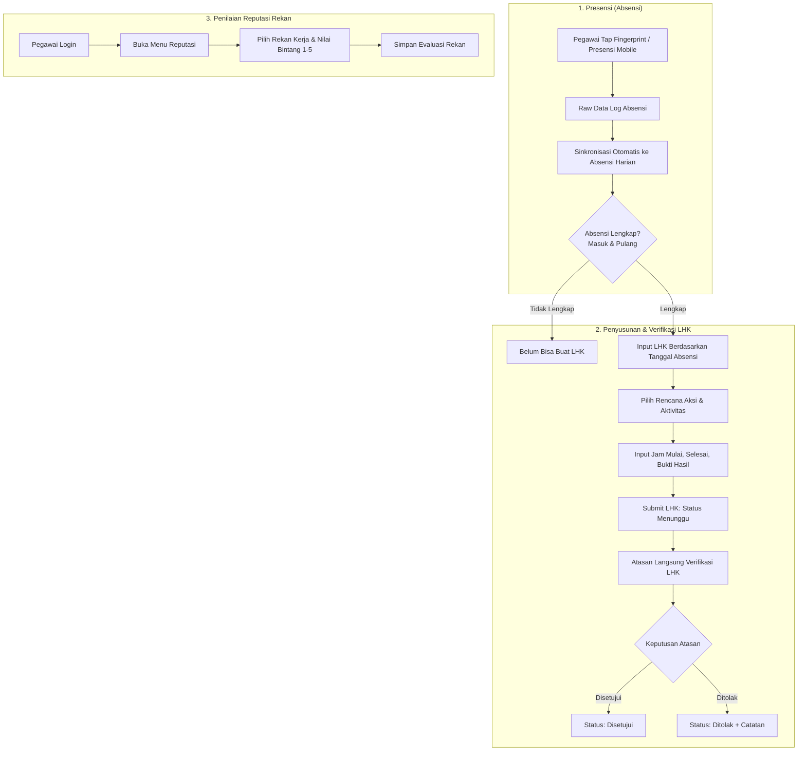

# Sakti (Sistem Administrasi Kinerja Terintegrasi)

Sistem Administrasi Kinerja Terintegrasi (Sakti) — Sistem Informasi Manajemen Presensi Pegawai dan Laporan Harian Kinerja (LHK) berbasis web dan mobile, terintegrasi langsung dengan mesin fingerprint (ZKTeco) serta mendukung aplikasi mobile berbasis Flutter dan PWA Livewire.

---

## 🛠️ Stack Teknologi

- **Backend & Admin Panel**: [Laravel 12](https://laravel.com), [Filament 4.x/5.x](https://filamentphp.com), [Livewire 3/4](https://livewire.laravel.com)
- **Bahasa Pemrograman**: PHP 8.3+
- **Database**: MySQL 8.0+
- **Integrasi Hardware**: ZKTeco Standalone Fingerprint Protocol via `rats/zkteco`
- **Role-Based Access Control (RBAC)**: `bezhansalleh/filament-shield` (Spatie Permission)
- **API Mobile Client**: Laravel Sanctum (mendukung aplikasi Flutter `absensi_flutter`)
- **Frontend / Styling**: Tailwind CSS, Filament Dark/Light Mode Theme

---

## 🧭 Struktur Menu & Navigasi Panel Admin

Sistem dikelompokkan ke dalam 4 modul besar yang teratur dan intuitif:

```txt
┌─────────────────────────────────────────────────────────────────┐
│                       STRUKTUR MENU PANEL                       │
├──────────────────┬──────────────────┬──────────────┬────────────┤
│   1. ABSENSI     │      2. LHK      │3. MASTER DATA│ 4. KONFIG  │
├──────────────────┼──────────────────┼──────────────┼────────────┤
│ • Absensi Harian │ • Laporan LHK    │ • Data       │ • Mesin    │
│ • Log Absensi    │ • Rencana Aksi   │   Pegawai    │   Absensi  │
│                  │ • Data Aktivitas │ • Instansi   │ • Roles &  │
│                  │ • Reputasi       │ • Bidang     │   Perms    │
│                  │                  │ • Jabatan    │            │
└──────────────────┴──────────────────┴──────────────┴────────────┘
```

1. **Absensi**:
   - **Data Absensi Harian**: Rekapitulasi absensi harian pegawai (jam masuk, jam pulang, status kehadiran: Hadir, Terlambat, Dinas Luar, Izin, Sakit, Tidak Hadir).
   - **Log Absensi**: Catatan riwayat mentah (*raw log*) dari mesin fingerprint maupun input aplikasi mobile, lengkap dengan aksi tarik log otomatis dari IP mesin.
2. **LHK (Laporan Harian Kinerja)**:
   - **Laporan LHK**: Entri dan verifikasi laporan pekerjaan harian pegawai.
   - **Data Rencana Aksi**: Master rencana aksi SKP pegawai.
   - **Data Aktivitas**: Rincian sub-aktivitas turunan rencana aksi beserta standar estimasi menit kerja.
   - **Reputasi**: Penilaian peer-to-peer antar rekan kerja (rating 1-5 bintang) dengan catatan objektif.
3. **Master Data**:
   - **Data Pegawai**: Master pengguna (NIP, Nama, Jabatan, Bidang, Atasan Langsung, Hak Akses, Status Aktif).
   - **Data Instansi**: Profil organisasi/kedinasan.
   - **Data Bidang**: Struktur bidang/divisi dalam instansi.
   - **Data Jabatan**: Daftar jabatan struktural dan fungsional.
4. **Konfigurasi Sistem**:
   - **Pengaturan Mesin**: Manajemen IP address, port, password komunikasi, dan status aktif mesin absensi.
   - **Peran & Hak Akses (Shield)**: Konfigurasi permission tiap role pengguna.

---

## 🔄 Alur Kerja Aplikasi (Application Flow)



### 1. Alur Presensi (Absensi Pegawai)
1. **Perekaman Log Presensi**:
   - Pegawai melakukan sidik jari pada mesin ZKTeco saat datang dan pulang.
   - Alternatif: Pegawai melakukan presensi melalui aplikasi mobile (PWA/Flutter).
2. **Sinkronisasi & Rekapitulasi Harian**:
   - Sistem menarik log mesin secara terjadwal atau melalui tombol *"Tarik Log Absensi Mesin"*.
   - Data diproses menjadi entri **Absensi Harian**:
     - Log pertama pada hari itu dijadikan **Jam Masuk**.
     - Log terakhir pada rentang jam pulang dijadikan **Jam Pulang**.
     - Status otomatis ditentukan (Hadir, Terlambat, dll).

### 2. Alur Pengisian & Verifikasi LHK
1. **Validasi Absensi**:
   - Pembuatan LHK mewajibkan pegawai memiliki absensi **Masuk** dan **Pulang** yang lengkap pada tanggal bersangkutan.
2. **Pengisian Rincian Pekerjaan**:
   - Pegawai memilih tanggal kehadiran yang telah terekam.
   - Menambahkan pekerjaan yang terhubung ke master **Rencana Aksi** dan **Aktivitas**.
   - Sistem otomatis menghitung durasi pengerjaan (dalam menit).
   - Menyertakan deskripsi hasil pekerjaan dan tautan bukti (*Google Drive, dokumen, foto, dsb.*).
3. **Persetujuan Atasan Langsung**:
   - LHK yang dikirimkan berstatus `menunggu`.
   - Atasan langsung (Kepala Bidang/Sekretaris/Kepala Dinas) meninjau daftar pekerjaan dan memberikan verifikasi `disetujui` atau `ditolak`.

### 3. Alur Evaluasi Reputasi (Peer-to-Peer Review)
- Pegawai dapat memberikan apresiasi dan penilaian kinerja kepada rekan kerja dalam satu instansi.
- Penilaian menggunakan skala rating 1 s/d 5 bintang dengan tanggal penilaian berformat standar Indonesia (`DD/MM/YYYY`) dan catatan kualitatif.

---

## 📱 Integrasi Mobile (API & Flutter)

Aplikasi menyediakan RESTful API berbasis Laravel Sanctum di `/api`:
- `POST /api/login`: Autentikasi pegawai & penerbitan token Sanctum.
- `GET /api/me`: Mengambil data profil pegawai yang sedang login.
- `GET /api/dashboard`: Rekap kehadiran dan statistik LHK pegawai.
- `GET /api/absensi/today`: Status presensi hari ini.
- `POST /api/absensi`: Kirim presensi mobile.
- `GET /api/lhk`: Riwayat dan daftar LHK pegawai.
- `POST /api/lhk`: Pengiriman LHK harian baru.
- `GET /api/lhk/aktivitas`: Daftar aktivitas yang tersedia untuk dipilih.

---

## 🚀 Panduan Instalasi & Menjalankan Proyek

### 1. Kebutuhan Sistem
- PHP >= 8.3
- Composer >= 2.5
- Node.js & NPM
- MySQL >= 8.0

### 2. Langkah Instalasi
```bash
# 1. Clone repository & masuk ke direktori
cd c:/laragon/www/sakti

# 2. Salin environment & atur konfigurasi database
cp .env.example .env

# 3. Install dependency PHP & Node.js
composer install
npm install

# 4. Generate application key
php artisan key:generate

# 5. Jalankan migrasi dan seeder
php artisan migrate --seed

# 6. Buat link storage
php artisan storage:link

# 7. Bersihkan cache
php artisan optimize:clear
```

### 3. Menjalankan Server Development
```bash
# Menjalankan Laravel, Vite, dan Queue secara serentak
composer run dev

# Atau jalankan secara terpisah:
php artisan serve
npm run dev
```

Akses panel admin di browser:
- URL: `http://localhost:8000/admin`
- Mobile Web: `http://localhost:8000/mobile`
